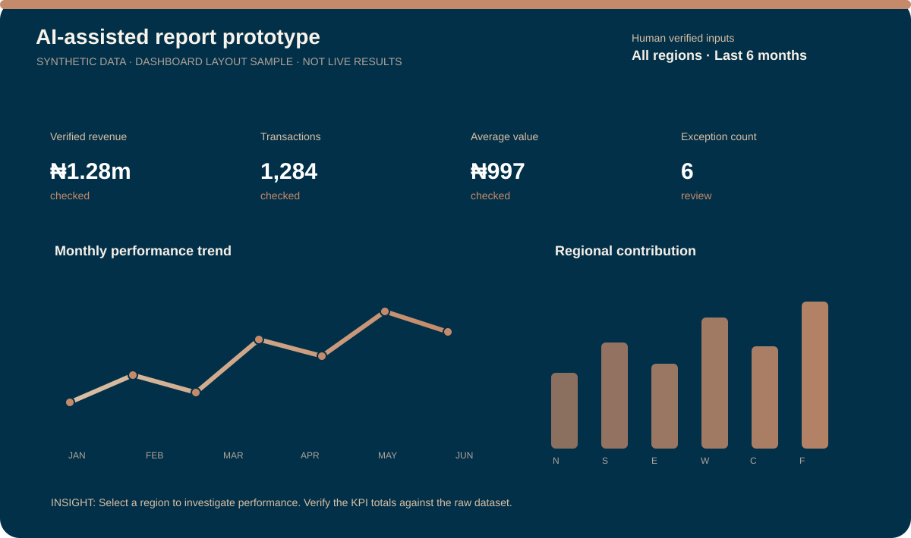

# AI for Data Analysis · Week 08 · Designing dashboards with AI assistance

> DataLearning comprehensive practical lesson. Data is fictional. This worksheet supports the full in-app explanation and independent practice. Do not overwrite your raw source file.

## Learning outcome
Use AI to critique dashboard wireframes and propose layouts that make KPIs and filters understandable.

## Where to begin in the tool
Share only fictional dashboard requirements or a safe mock screenshot; request a concrete layout and interaction checklist.


## Source data dictionary · exact practice file fields
The linked CSV uses these **exact header names**. Import the file before attempting examples. If an exercise uses a friendly or calculated name, map or create it first.

`session_id, variant, converted, device, region, basket_items`

The worked example may introduce derived fields or example tables. Create or rename those fields explicitly and verify results against these original source columns.

## Dataset and companion video
- **Download the dataset:** [`learning_experiment.csv`](../learning_experiment.csv)
- **Video companion:** https://www.youtube.com/watch?v=pkYkeIdhlT0 (the in-app Watch button opens the YouTube player when embedding is permitted).
- **Reading order:** first identify controls, then read the four concepts, reproduce the example, try an independent case, and validate your evidence.

## Explain the four essential concepts
### 1. Information hierarchy
place executive KPIs first then explanatory trend and ranking

### 2. Visual semantics
keep consistent definitions and units

### 3. Interactive controls
ensure slicer behaviour and empty states are testable

### 4. Human review
compare the AI proposal with data-quality and accessibility requirements.

## Why this skill matters
Why this skill matters: A new BI team needs fast layout ideas but must ensure the published report remains technically sound. The method is not only about producing an attractive figure. Interactive controls: ensure slicer behaviour and empty states are testable Human review: compare the AI proposal with data-quality and accessibility requirements. When preparing an output for another person, specify the reporting period, units, selection rules and known limitations. An analyst should be able to explain why a calculation or chart answers the actual business question and reproduce the result.

## Guided practice · follow all four steps
1. Open the correct workspace and identify the controls before entering commands. Share only fictional dashboard requirements or a safe mock screenshot; request a concrete layout and interaction checklist. Keep an untouched source or backup version so a mistake is reversible.
2. Apply the first two concepts on a small example: Information hierarchy — place executive KPIs first then explanatory trend and ranking Then test visual semantics with at least two contrasting inputs.
3. Reproduce the worked example below exactly, then change one input or filter. Explain which value changes and why. After that, apply interactive controls and inspect the output for errors.
4. Complete the independent challenge: Sketch a dashboard based on AI suggestions and annotate each visual with the business question it answers. Before moving on, check the result against the acceptance criteria: Every visual has a purpose, consistent filters and a reproducible metric definition.

## Study this worked example
```text
Prompt: 'Design a 16:9 retail dashboard wireframe with Revenue, Orders, AOV, trend, region ranking and a filter panel. Explain reading order.'
```

**How to interpret the output:** Designing dashboards with AI assistance begins with a practical objective: Use AI to critique dashboard wireframes and propose layouts that make KPIs and filters understandable. In AI for Data Analysis, begin by understanding the workspace and the data rather than memorising a command. Information hierarchy: place executive KPIs first then explanatory trend and ranking Visual semantics: keep consistent definitions and units Practice these ideas on a small synthetic sample first. Notice where the tool shows inputs, intermediate results and errors; then describe in plain language what each operation does and what it does not prove. Keep original records separate from working calculations so you can trace any surprising result back to its source.

## Business case study
Business case: A new BI team needs fast layout ideas but must ensure the published report remains technically sound. Your role is to deliver a result that a manager can trust and act upon, not merely a screenshot. First describe what records are included and excluded. Next perform the method described in this week, and record any changes to the source. Use the worked example as a starting point but test it with different values; finally communicate one relevant observation, one limitation and a follow-up.

## Independent practical challenge
Sketch a dashboard based on AI suggestions and annotate each visual with the business question it answers.

**What you should hand in:** Every visual has a purpose, consistent filters and a reproducible metric definition.

## Check your result (after attempting)
Expected evidence: Every visual has a purpose, consistent filters and a reproducible metric definition. To validate it, compare a small hand-checked sample with the final output, test an alternative filter or a changed input, and record any unmatched, missing or suspicious data. If results differ, review the original data, formula or query, aggregation grain and selected filters before sharing the report. Avoid this common error: Treating a generated dashboard image as evidence of working relationships or real KPI calculations.

**Common failure:** Treating a generated dashboard image as evidence of working relationships or real KPI calculations.

## Reflect and explain the result
- Which menu, editor or pane did you use, and why?
- What is the data grain, metric definition or calculated rule?
- Can a second learner reproduce your output using the dataset and your instructions?
- Which number, chart or limitation must be mentioned when presenting your result?

## Dashboard design reference


Study the KPI strip, timeline, ranking, filters and notes. It is an illustrative wireframe, not a working dashboard or calculated analysis.

---
**Progress note:** Completing this worksheet is practice. Marking a week complete, passing an assessment and submitting an instructor-reviewed capstone are separate actions in DataLearning.
