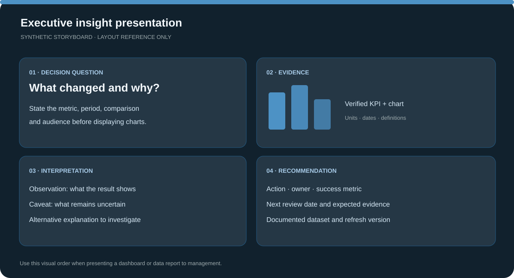

# AI for Data Analysis · Week 09 · Reviewing AI-written reports and building a safe workflow

> DataLearning comprehensive practical lesson. Data is fictional. This worksheet supports the full in-app explanation and independent practice. Do not overwrite your raw source file.

## Learning outcome
Create a reliable human approval path for AI-generated analysis and reporting deliverables.

## Where to begin in the tool
Prepare a draft report from verified synthetic KPIs, then audit the numbers, citations and confidential content.


## Source data dictionary · exact practice file fields
The linked CSV uses these **exact header names**. Import the file before attempting examples. If an exercise uses a friendly or calculated name, map or create it first.

`case_id, topic, initial_prompt, risk, analyst_control`

The worked example may introduce derived fields or example tables. Create or rename those fields explicitly and verify results against these original source columns.

## Dataset and companion video
- **Download the dataset:** [`learning_ai_review_cases.csv`](../learning_ai_review_cases.csv)
- **Video companion:** https://www.youtube.com/watch?v=pkYkeIdhlT0 (the in-app Watch button opens the YouTube player when embedding is permitted).
- **Reading order:** first identify controls, then read the four concepts, reproduce the example, try an independent case, and validate your evidence.

## Explain the four essential concepts
### 1. Fact register
log each claim and its source calculation

### 2. Quality gate
require another reviewer before distribution

### 3. Automation limits
keep external sending or data changes behind explicit approval

### 4. Governance
state which AI tool was used and what data was shared.

## Why this skill matters
Why this skill matters: A finance unit is piloting AI-supported reports and needs a defensible audit trail. The method is not only about producing an attractive figure. Automation limits: keep external sending or data changes behind explicit approval Governance: state which AI tool was used and what data was shared. When preparing an output for another person, specify the reporting period, units, selection rules and known limitations. An analyst should be able to explain why a calculation or chart answers the actual business question and reproduce the result.

## Guided practice · follow all four steps
1. Open the correct workspace and identify the controls before entering commands. Prepare a draft report from verified synthetic KPIs, then audit the numbers, citations and confidential content. Keep an untouched source or backup version so a mistake is reversible.
2. Apply the first two concepts on a small example: Fact register — log each claim and its source calculation Then test quality gate with at least two contrasting inputs.
3. Reproduce the worked example below exactly, then change one input or filter. Explain which value changes and why. After that, apply automation limits and inspect the output for errors.
4. Complete the independent challenge: Audit a one-page AI-generated executive summary, correct at least two weaknesses and write an AI-use disclosure. Before moving on, check the result against the acceptance criteria: Every headline statistic appears in your evidence register, and recommendations are identified as recommendations.

## Study this worked example
```text
Review checklist: Claim → Source → Calculation → Evidence → Reviewer → Approved?
```

**How to interpret the output:** Reviewing AI-written reports and building a safe workflow begins with a practical objective: Create a reliable human approval path for AI-generated analysis and reporting deliverables. In AI for Data Analysis, begin by understanding the workspace and the data rather than memorising a command. Fact register: log each claim and its source calculation Quality gate: require another reviewer before distribution Practice these ideas on a small synthetic sample first. Notice where the tool shows inputs, intermediate results and errors; then describe in plain language what each operation does and what it does not prove. Keep original records separate from working calculations so you can trace any surprising result back to its source.

## Business case study
Business case: A finance unit is piloting AI-supported reports and needs a defensible audit trail. Your role is to deliver a result that a manager can trust and act upon, not merely a screenshot. First describe what records are included and excluded. Next perform the method described in this week, and record any changes to the source. Use the worked example as a starting point but test it with different values; finally communicate one relevant observation, one limitation and a follow-up.

## Independent practical challenge
Audit a one-page AI-generated executive summary, correct at least two weaknesses and write an AI-use disclosure.

**What you should hand in:** Every headline statistic appears in your evidence register, and recommendations are identified as recommendations.

## Check your result (after attempting)
Expected evidence: Every headline statistic appears in your evidence register, and recommendations are identified as recommendations. To validate it, compare a small hand-checked sample with the final output, test an alternative filter or a changed input, and record any unmatched, missing or suspicious data. If results differ, review the original data, formula or query, aggregation grain and selected filters before sharing the report. Avoid this common error: Allowing an agent to email an unverified management report without human sign-off.

**Common failure:** Allowing an agent to email an unverified management report without human sign-off.

## Reflect and explain the result
- Which menu, editor or pane did you use, and why?
- What is the data grain, metric definition or calculated rule?
- Can a second learner reproduce your output using the dataset and your instructions?
- Which number, chart or limitation must be mentioned when presenting your result?

## Management report presentation layout


Follow the order: decision question, verified evidence, interpretation and recommended action.

---
**Progress note:** Completing this worksheet is practice. Marking a week complete, passing an assessment and submitting an instructor-reviewed capstone are separate actions in DataLearning.
