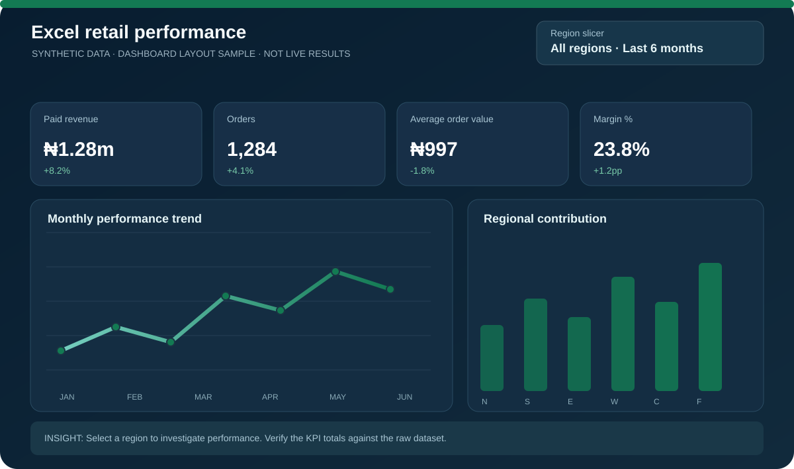

# Microsoft Excel · Week 08 · Building a professional interactive Excel dashboard

> DataLearning comprehensive practical lesson. Data is fictional. This worksheet supports the full in-app explanation and independent practice. Do not overwrite your raw source file.

## Learning outcome
Arrange KPI cards, PivotCharts and slicers into one readable decision-making page.

## Where to begin in the tool
Create a Dashboard worksheet, switch off Gridlines, add a title and align visuals using Format > Align.


## Source data dictionary · exact practice file fields
The linked CSV uses these **exact header names**. Import the file before attempting examples. If an exercise uses a friendly or calculated name, map or create it first.

`order_id, order_date, region, category, quantity, unit_price_ngn, unit_cost_ngn, status, customer_id, channel`

Available `status` values: `Cancelled`, `Completed`, `Returned`

The worked example may introduce derived fields or example tables. Create or rename those fields explicitly and verify results against these original source columns. Source status values are Cancelled, Completed, Returned.

## Dataset and companion video
- **Download the dataset:** [`learning_sales_2026.csv`](../learning_sales_2026.csv)
- **Video companion:** https://www.youtube.com/watch?v=lH7HfwUFnYA (the in-app Watch button opens the YouTube player when embedding is permitted).
- **Reading order:** first identify controls, then read the four concepts, reproduce the example, try an independent case, and validate your evidence.

## Explain the four essential concepts
### 1. Visual hierarchy
place title, date range and three KPIs at the top

### 2. Story flow
show revenue trend, region contribution and top products in a predictable grid

### 3. Interaction
link slicers to PivotTables that share a source and test every selection

### 4. Design checks
ensure consistent fonts, readable labels, whitespace and clear empty states.

## Why this skill matters
Why this skill matters: A retail manager needs a self-service Excel performance dashboard for weekly executive meetings. The method is not only about producing an attractive figure. Interaction: link slicers to PivotTables that share a source and test every selection Design checks: ensure consistent fonts, readable labels, whitespace and clear empty states. When preparing an output for another person, specify the reporting period, units, selection rules and known limitations. An analyst should be able to explain why a calculation or chart answers the actual business question and reproduce the result.

## Guided practice · follow all four steps
1. Open the correct workspace and identify the controls before entering commands. Create a Dashboard worksheet, switch off Gridlines, add a title and align visuals using Format > Align. Keep an untouched source or backup version so a mistake is reversible.
2. Apply the first two concepts on a small example: Visual hierarchy — place title, date range and three KPIs at the top Then test story flow with at least two contrasting inputs.
3. Reproduce the worked example below exactly, then change one input or filter. Explain which value changes and why. After that, apply interaction and inspect the output for errors.
4. Complete the independent challenge: Build a one-page dashboard with at least three KPIs, two charts and a slicer; compare its totals with your source Table. Before moving on, check the result against the acceptance criteria: Changing the Region slicer must update the connected metrics; original overall totals must remain recoverable.

## Study this worked example
```text
Top row: Total Revenue | Orders | Average Order Value
Middle: Monthly Trend | Region Ranking
Bottom: Top Products | Filters / Notes
```

**How to interpret the output:** Building a professional interactive Excel dashboard begins with a practical objective: Arrange KPI cards, PivotCharts and slicers into one readable decision-making page. In Microsoft Excel, begin by understanding the workspace and the data rather than memorising a command. Visual hierarchy: place title, date range and three KPIs at the top Story flow: show revenue trend, region contribution and top products in a predictable grid Practice these ideas on a small synthetic sample first. Notice where the tool shows inputs, intermediate results and errors; then describe in plain language what each operation does and what it does not prove. Keep original records separate from working calculations so you can trace any surprising result back to its source.

## Business case study
Business case: A retail manager needs a self-service Excel performance dashboard for weekly executive meetings. Your role is to deliver a result that a manager can trust and act upon, not merely a screenshot. First describe what records are included and excluded. Next perform the method described in this week, and record any changes to the source. Use the worked example as a starting point but test it with different values; finally communicate one relevant observation, one limitation and a follow-up.

## Independent practical challenge
Build a one-page dashboard with at least three KPIs, two charts and a slicer; compare its totals with your source Table.

**What you should hand in:** Changing the Region slicer must update the connected metrics; original overall totals must remain recoverable.

## Check your result (after attempting)
Expected evidence: Changing the Region slicer must update the connected metrics; original overall totals must remain recoverable. To validate it, compare a small hand-checked sample with the final output, test an alternative filter or a changed input, and record any unmatched, missing or suspicious data. If results differ, review the original data, formula or query, aggregation grain and selected filters before sharing the report. Avoid this common error: Placing decorative charts without a question, or showing conflicting totals from disconnected pivots.

**Common failure:** Placing decorative charts without a question, or showing conflicting totals from disconnected pivots.

## Reflect and explain the result
- Which menu, editor or pane did you use, and why?
- What is the data grain, metric definition or calculated rule?
- Can a second learner reproduce your output using the dataset and your instructions?
- Which number, chart or limitation must be mentioned when presenting your result?

## Dashboard design reference


Study the KPI strip, timeline, ranking, filters and notes. It is an illustrative wireframe, not a working dashboard or calculated analysis.

---
**Progress note:** Completing this worksheet is practice. Marking a week complete, passing an assessment and submitting an instructor-reviewed capstone are separate actions in DataLearning.
