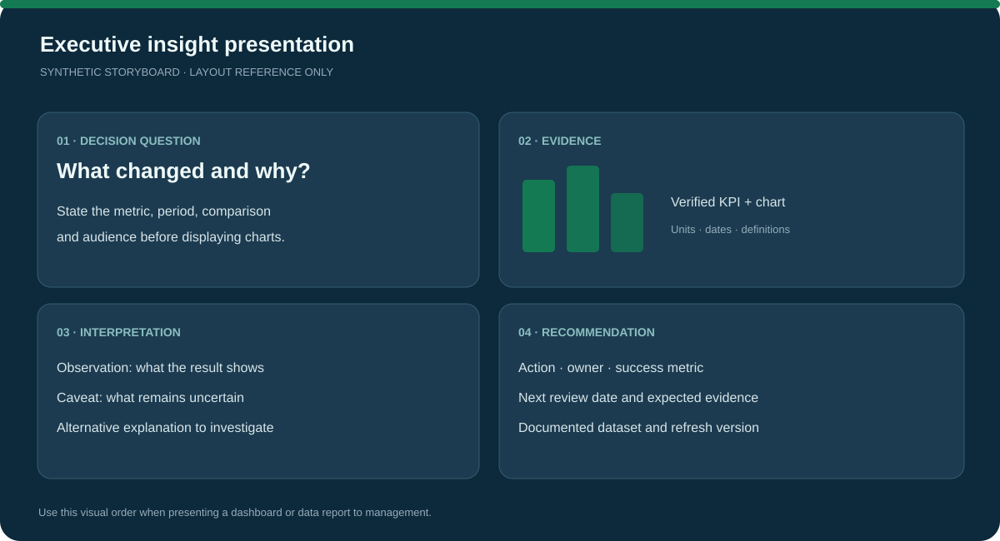

# Microsoft Excel · Week 09 · Writing and presenting an Excel management report

> DataLearning comprehensive practical lesson. Data is fictional. This worksheet supports the full in-app explanation and independent practice. Do not overwrite your raw source file.

## Learning outcome
Turn dashboard findings into a concise business narrative and deliver a portable report.

## Where to begin in the tool
Use Page Layout > Print Area, Export > PDF and a short Insights sheet with assumptions and decisions.


## Source data dictionary · exact practice file fields
The linked CSV uses these **exact header names**. Import the file before attempting examples. If an exercise uses a friendly or calculated name, map or create it first.

`month, region, net_sales_ngn, sales_target_ngn, gross_profit_ngn, order_count, late_shipments, returned_orders`

The worked example may introduce derived fields or example tables. Create or rename those fields explicitly and verify results against these original source columns.

## Dataset and companion video
- **Download the dataset:** [`learning_monthly_kpis.csv`](../learning_monthly_kpis.csv)
- **Video companion:** https://www.youtube.com/watch?v=PSNXoAs2FtQ&t=21589s (the in-app Watch button opens the YouTube player when embedding is permitted).
- **Reading order:** first identify controls, then read the four concepts, reproduce the example, try an independent case, and validate your evidence.

## Explain the four essential concepts
### 1. Observation versus explanation
show what changed before speculating why

### 2. Variance
calculate actual-minus-target and percentage change with correct denominators

### 3. Recommendation
link an action to the observed issue and a measurable follow-up

### 4. Handover
include period, data source, refresh date and limitations for the recipient.

## Why this skill matters
Why this skill matters: A head of operations needs an evidence-based monthly performance report that can be discussed in five minutes. The method is not only about producing an attractive figure. Recommendation: link an action to the observed issue and a measurable follow-up Handover: include period, data source, refresh date and limitations for the recipient. When preparing an output for another person, specify the reporting period, units, selection rules and known limitations. An analyst should be able to explain why a calculation or chart answers the actual business question and reproduce the result.

## Guided practice · follow all four steps
1. Open the correct workspace and identify the controls before entering commands. Use Page Layout > Print Area, Export > PDF and a short Insights sheet with assumptions and decisions. Keep an untouched source or backup version so a mistake is reversible.
2. Apply the first two concepts on a small example: Observation versus explanation — show what changed before speculating why Then test variance with at least two contrasting inputs.
3. Reproduce the worked example below exactly, then change one input or filter. Explain which value changes and why. After that, apply recommendation and inspect the output for errors.
4. Complete the independent challenge: Write a one-page executive summary supported by dashboard screenshots and three priority recommendations. Before moving on, check the result against the acceptance criteria: Explain the ₦60,000 shortfall as a -6.67% variance against target; disclose unknown causes until investigated.

## Study this worked example
```text
Actual 840000; target 900000
Gap = -60000; variance % = -60000/900000 = -6.67%
```

**How to interpret the output:** Writing and presenting an Excel management report begins with a practical objective: Turn dashboard findings into a concise business narrative and deliver a portable report. In Microsoft Excel, begin by understanding the workspace and the data rather than memorising a command. Observation versus explanation: show what changed before speculating why Variance: calculate actual-minus-target and percentage change with correct denominators Practice these ideas on a small synthetic sample first. Notice where the tool shows inputs, intermediate results and errors; then describe in plain language what each operation does and what it does not prove. Keep original records separate from working calculations so you can trace any surprising result back to its source.

## Business case study
Business case: A head of operations needs an evidence-based monthly performance report that can be discussed in five minutes. Your role is to deliver a result that a manager can trust and act upon, not merely a screenshot. First describe what records are included and excluded. Next perform the method described in this week, and record any changes to the source. Use the worked example as a starting point but test it with different values; finally communicate one relevant observation, one limitation and a follow-up.

## Independent practical challenge
Write a one-page executive summary supported by dashboard screenshots and three priority recommendations.

**What you should hand in:** Explain the ₦60,000 shortfall as a -6.67% variance against target; disclose unknown causes until investigated.

## Check your result (after attempting)
Expected evidence: Explain the ₦60,000 shortfall as a -6.67% variance against target; disclose unknown causes until investigated. To validate it, compare a small hand-checked sample with the final output, test an alternative filter or a changed input, and record any unmatched, missing or suspicious data. If results differ, review the original data, formula or query, aggregation grain and selected filters before sharing the report. Avoid this common error: Reporting a percentage without its base or sharing screenshots with unreadable labels.

**Common failure:** Reporting a percentage without its base or sharing screenshots with unreadable labels.

## Reflect and explain the result
- Which menu, editor or pane did you use, and why?
- What is the data grain, metric definition or calculated rule?
- Can a second learner reproduce your output using the dataset and your instructions?
- Which number, chart or limitation must be mentioned when presenting your result?

## Management report presentation layout


Follow the order: decision question, verified evidence, interpretation and recommended action.

---
**Progress note:** Completing this worksheet is practice. Marking a week complete, passing an assessment and submitting an instructor-reviewed capstone are separate actions in DataLearning.
