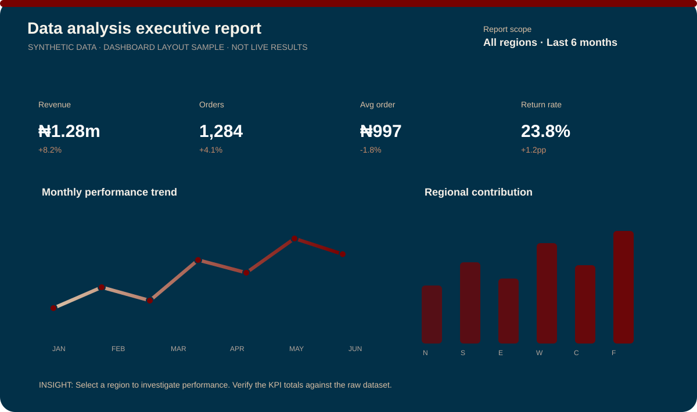

# Data Analysis · Week 08 · Planning the first dashboard and selecting KPIs

> DataLearning comprehensive practical lesson. Data is fictional. This worksheet supports the full in-app explanation and independent practice. Do not overwrite your raw source file.

## Learning outcome
Design a clean dashboard layout before choosing a complicated tool.

## Where to begin in the tool
Sketch a 16:9 report page using a title, KPI strip, explanatory charts and a filter area.


## Source data dictionary · exact practice file fields
The linked CSV uses these **exact header names**. Import the file before attempting examples. If an exercise uses a friendly or calculated name, map or create it first.

`employee_id, department, region, monthly_hours, completed_tasks, status`

Available `status` values: `Active`, `On leave`

The worked example may introduce derived fields or example tables. Create or rename those fields explicitly and verify results against these original source columns. Source status values are Active, On leave.

## Dataset and companion video
- **Download the dataset:** [`learning_staff_operations.csv`](../learning_staff_operations.csv)
- **Video companion:** https://www.youtube.com/watch?v=TImRJTzphhE (the in-app Watch button opens the YouTube player when embedding is permitted).
- **Reading order:** first identify controls, then read the four concepts, reproduce the example, try an independent case, and validate your evidence.

## Explain the four essential concepts
### 1. Information hierarchy
headline results should be visible first

### 2. Metric definitions
Revenue and AOV need agreed inclusion rules

### 3. Interaction
filters must update connected visuals consistently

### 4. Accessibility
readable labels and purposeful whitespace beat visual clutter.

## Why this skill matters
Why this skill matters: A retail leadership team wants an outline of its first self-service sales dashboard. The method is not only about producing an attractive figure. Interaction: filters must update connected visuals consistently Accessibility: readable labels and purposeful whitespace beat visual clutter. When preparing an output for another person, specify the reporting period, units, selection rules and known limitations. An analyst should be able to explain why a calculation or chart answers the actual business question and reproduce the result.

## Guided practice · follow all four steps
1. Open the correct workspace and identify the controls before entering commands. Sketch a 16:9 report page using a title, KPI strip, explanatory charts and a filter area. Keep an untouched source or backup version so a mistake is reversible.
2. Apply the first two concepts on a small example: Information hierarchy — headline results should be visible first Then test metric definitions with at least two contrasting inputs.
3. Reproduce the worked example below exactly, then change one input or filter. Explain which value changes and why. After that, apply interaction and inspect the output for errors.
4. Complete the independent challenge: Create a dashboard wireframe and map each KPI to a source column and calculation. Before moving on, check the result against the acceptance criteria: A reader can answer the business question in 30 seconds and every visual has a clear purpose.

## Study this worked example
```text
Top: Revenue | Orders | AOV
Middle: Trend | Region Ranking
Bottom: Notes | Filters
```

**How to interpret the output:** Planning the first dashboard and selecting KPIs begins with a practical objective: Design a clean dashboard layout before choosing a complicated tool. In Data Analysis, begin by understanding the workspace and the data rather than memorising a command. Information hierarchy: headline results should be visible first Metric definitions: Revenue and AOV need agreed inclusion rules Practice these ideas on a small synthetic sample first. Notice where the tool shows inputs, intermediate results and errors; then describe in plain language what each operation does and what it does not prove. Keep original records separate from working calculations so you can trace any surprising result back to its source.

## Business case study
Business case: A retail leadership team wants an outline of its first self-service sales dashboard. Your role is to deliver a result that a manager can trust and act upon, not merely a screenshot. First describe what records are included and excluded. Next perform the method described in this week, and record any changes to the source. Use the worked example as a starting point but test it with different values; finally communicate one relevant observation, one limitation and a follow-up.

## Independent practical challenge
Create a dashboard wireframe and map each KPI to a source column and calculation.

**What you should hand in:** A reader can answer the business question in 30 seconds and every visual has a clear purpose.

## Check your result (after attempting)
Expected evidence: A reader can answer the business question in 30 seconds and every visual has a clear purpose. To validate it, compare a small hand-checked sample with the final output, test an alternative filter or a changed input, and record any unmatched, missing or suspicious data. If results differ, review the original data, formula or query, aggregation grain and selected filters before sharing the report. Avoid this common error: Adding flashy charts that do not connect to a decision or have inconsistent filters.

**Common failure:** Adding flashy charts that do not connect to a decision or have inconsistent filters.

## Reflect and explain the result
- Which menu, editor or pane did you use, and why?
- What is the data grain, metric definition or calculated rule?
- Can a second learner reproduce your output using the dataset and your instructions?
- Which number, chart or limitation must be mentioned when presenting your result?

## Dashboard design reference


Study the KPI strip, timeline, ranking, filters and notes. It is an illustrative wireframe, not a working dashboard or calculated analysis.

---
**Progress note:** Completing this worksheet is practice. Marking a week complete, passing an assessment and submitting an instructor-reviewed capstone are separate actions in DataLearning.
