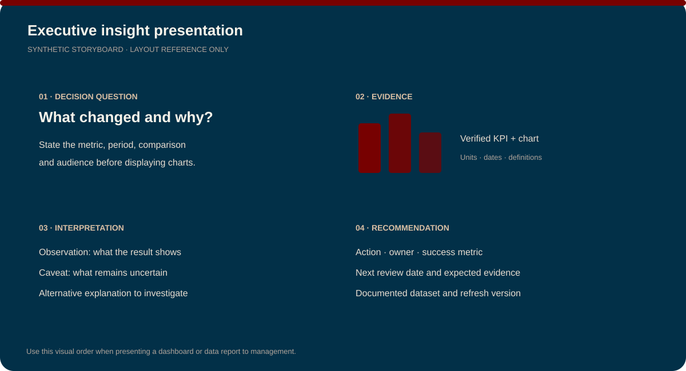

# Data Analysis · Week 09 · Explaining results and writing an executive briefing

> DataLearning comprehensive practical lesson. Data is fictional. This worksheet supports the full in-app explanation and independent practice. Do not overwrite your raw source file.

## Learning outcome
Write an evidence-first management report and prepare a brief verbal presentation.

## Where to begin in the tool
Use a one-page slide or document with Insight, Evidence, Implication and Next Action sections.


## Source data dictionary · exact practice file fields
The linked CSV uses these **exact header names**. Import the file before attempting examples. If an exercise uses a friendly or calculated name, map or create it first.

`month, region, net_sales_ngn, sales_target_ngn, gross_profit_ngn, order_count, late_shipments, returned_orders`

The worked example may introduce derived fields or example tables. Create or rename those fields explicitly and verify results against these original source columns.

## Dataset and companion video
- **Download the dataset:** [`learning_monthly_kpis.csv`](../learning_monthly_kpis.csv)
- **Video companion:** https://www.youtube.com/watch?v=PSNXoAs2FtQ&t=29175s (the in-app Watch button opens the YouTube player when embedding is permitted).
- **Reading order:** first identify controls, then read the four concepts, reproduce the example, try an independent case, and validate your evidence.

## Explain the four essential concepts
### 1. Observation
state a calculated fact with time period

### 2. Evidence
include a reconciled KPI or chart

### 3. Uncertainty
do not invent causes or unsupported precision

### 4. Recommendation
propose a testable action and responsible owner.

## Why this skill matters
Why this skill matters: A team lead needs an answer to 'so what?' after reviewing a dashboard. The method is not only about producing an attractive figure. Uncertainty: do not invent causes or unsupported precision Recommendation: propose a testable action and responsible owner. When preparing an output for another person, specify the reporting period, units, selection rules and known limitations. An analyst should be able to explain why a calculation or chart answers the actual business question and reproduce the result.

## Guided practice · follow all four steps
1. Open the correct workspace and identify the controls before entering commands. Use a one-page slide or document with Insight, Evidence, Implication and Next Action sections. Keep an untouched source or backup version so a mistake is reversible.
2. Apply the first two concepts on a small example: Observation — state a calculated fact with time period Then test evidence with at least two contrasting inputs.
3. Reproduce the worked example below exactly, then change one input or filter. Explain which value changes and why. After that, apply uncertainty and inspect the output for errors.
4. Complete the independent challenge: Write a 120-word report and a two-minute presentation about an observed metric change. Before moving on, check the result against the acceptance criteria: The statement uses correct arithmetic, cites the reporting dataset and identifies what cannot yet be concluded.

## Study this worked example
```text
Observation: March revenue is 10% below February
Follow-up: Compare refunds and channel mix before making a claim
```

**How to interpret the output:** Explaining results and writing an executive briefing begins with a practical objective: Write an evidence-first management report and prepare a brief verbal presentation. In Data Analysis, begin by understanding the workspace and the data rather than memorising a command. Observation: state a calculated fact with time period Evidence: include a reconciled KPI or chart Practice these ideas on a small synthetic sample first. Notice where the tool shows inputs, intermediate results and errors; then describe in plain language what each operation does and what it does not prove. Keep original records separate from working calculations so you can trace any surprising result back to its source.

## Business case study
Business case: A team lead needs an answer to 'so what?' after reviewing a dashboard. Your role is to deliver a result that a manager can trust and act upon, not merely a screenshot. First describe what records are included and excluded. Next perform the method described in this week, and record any changes to the source. Use the worked example as a starting point but test it with different values; finally communicate one relevant observation, one limitation and a follow-up.

## Independent practical challenge
Write a 120-word report and a two-minute presentation about an observed metric change.

**What you should hand in:** The statement uses correct arithmetic, cites the reporting dataset and identifies what cannot yet be concluded.

## Check your result (after attempting)
Expected evidence: The statement uses correct arithmetic, cites the reporting dataset and identifies what cannot yet be concluded. To validate it, compare a small hand-checked sample with the final output, test an alternative filter or a changed input, and record any unmatched, missing or suspicious data. If results differ, review the original data, formula or query, aggregation grain and selected filters before sharing the report. Avoid this common error: Confusing correlation with cause or overloading a slide with raw data tables.

**Common failure:** Confusing correlation with cause or overloading a slide with raw data tables.

## Reflect and explain the result
- Which menu, editor or pane did you use, and why?
- What is the data grain, metric definition or calculated rule?
- Can a second learner reproduce your output using the dataset and your instructions?
- Which number, chart or limitation must be mentioned when presenting your result?

## Management report presentation layout


Follow the order: decision question, verified evidence, interpretation and recommended action.

---
**Progress note:** Completing this worksheet is practice. Marking a week complete, passing an assessment and submitting an instructor-reviewed capstone are separate actions in DataLearning.
