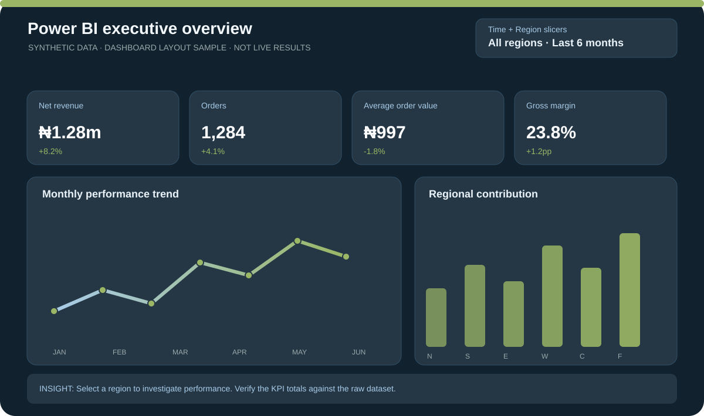

# Power BI Desktop · Week 08 · Building a premium interactive Power BI report

> DataLearning comprehensive practical lesson. Data is fictional. This worksheet supports the full in-app explanation and independent practice. Do not overwrite your raw source file.

## Learning outcome
Apply grid-based dashboard layout, slicers, bookmarks and visual hierarchy to a decision-ready report page.

## Where to begin in the tool
Set Page size, add a title and filter area, align and distribute visual containers, and use View > Selection where relevant.


## Source data dictionary · exact practice file fields
The linked CSV uses these **exact header names**. Import the file before attempting examples. If an exercise uses a friendly or calculated name, map or create it first.

`month, region, net_sales_ngn, sales_target_ngn, gross_profit_ngn, order_count, late_shipments, returned_orders`

The worked example may introduce derived fields or example tables. Create or rename those fields explicitly and verify results against these original source columns.

## Dataset and companion video
- **Download the dataset:** [`learning_monthly_kpis.csv`](../learning_monthly_kpis.csv)
- **Video companion:** https://www.youtube.com/watch?v=PSNXoAs2FtQ&t=36534s (the in-app Watch button opens the YouTube player when embedding is permitted).
- **Reading order:** first identify controls, then read the four concepts, reproduce the example, try an independent case, and validate your evidence.

## Explain the four essential concepts
### 1. Layout grid
create a strong heading, compact KPI strip and analytical middle row

### 2. Interaction design
group slicers, offer a clear reset method and test cross-filtering

### 3. Performance
minimise redundant high-cardinality visuals and expensive measures

### 4. Publishing readiness
document metric definitions, refresh timing and ownership.

## Why this skill matters
Why this skill matters: A board-facing monthly performance report needs a consistent 16:9 layout and immediately visible business context. The method is not only about producing an attractive figure. Performance: minimise redundant high-cardinality visuals and expensive measures Publishing readiness: document metric definitions, refresh timing and ownership. When preparing an output for another person, specify the reporting period, units, selection rules and known limitations. An analyst should be able to explain why a calculation or chart answers the actual business question and reproduce the result.

## Guided practice · follow all four steps
1. Open the correct workspace and identify the controls before entering commands. Set Page size, add a title and filter area, align and distribute visual containers, and use View > Selection where relevant. Keep an untouched source or backup version so a mistake is reversible.
2. Apply the first two concepts on a small example: Layout grid — create a strong heading, compact KPI strip and analytical middle row Then test interaction design with at least two contrasting inputs.
3. Reproduce the worked example below exactly, then change one input or filter. Explain which value changes and why. After that, apply performance and inspect the output for errors.
4. Complete the independent challenge: Produce an executive overview with four KPIs, trend and category views and a clear slicer group. Before moving on, check the result against the acceptance criteria: Every card must reconcile with its source measure; a reset state must restore the intended overview.

## Study this worked example
```text
Top: Total Revenue | AOV | Margin % | Orders
Middle: Monthly Revenue Trend | Region Ranking
Bottom: Product Mix | Insight & Actions
```

**How to interpret the output:** Building a premium interactive Power BI report begins with a practical objective: Apply grid-based dashboard layout, slicers, bookmarks and visual hierarchy to a decision-ready report page. In Power BI Desktop, begin by understanding the workspace and the data rather than memorising a command. Layout grid: create a strong heading, compact KPI strip and analytical middle row Interaction design: group slicers, offer a clear reset method and test cross-filtering Practice these ideas on a small synthetic sample first. Notice where the tool shows inputs, intermediate results and errors; then describe in plain language what each operation does and what it does not prove. Keep original records separate from working calculations so you can trace any surprising result back to its source.

## Business case study
Business case: A board-facing monthly performance report needs a consistent 16:9 layout and immediately visible business context. Your role is to deliver a result that a manager can trust and act upon, not merely a screenshot. First describe what records are included and excluded. Next perform the method described in this week, and record any changes to the source. Use the worked example as a starting point but test it with different values; finally communicate one relevant observation, one limitation and a follow-up.

## Independent practical challenge
Produce an executive overview with four KPIs, trend and category views and a clear slicer group.

**What you should hand in:** Every card must reconcile with its source measure; a reset state must restore the intended overview.

## Check your result (after attempting)
Expected evidence: Every card must reconcile with its source measure; a reset state must restore the intended overview. To validate it, compare a small hand-checked sample with the final output, test an alternative filter or a changed input, and record any unmatched, missing or suspicious data. If results differ, review the original data, formula or query, aggregation grain and selected filters before sharing the report. Avoid this common error: Making the page impressive but unreadable at real display size or allowing unrelated visual interactions.

**Common failure:** Making the page impressive but unreadable at real display size or allowing unrelated visual interactions.

## Reflect and explain the result
- Which menu, editor or pane did you use, and why?
- What is the data grain, metric definition or calculated rule?
- Can a second learner reproduce your output using the dataset and your instructions?
- Which number, chart or limitation must be mentioned when presenting your result?

## Dashboard design reference


Study the KPI strip, timeline, ranking, filters and notes. It is an illustrative wireframe, not a working dashboard or calculated analysis.

---
**Progress note:** Completing this worksheet is practice. Marking a week complete, passing an assessment and submitting an instructor-reviewed capstone are separate actions in DataLearning.
