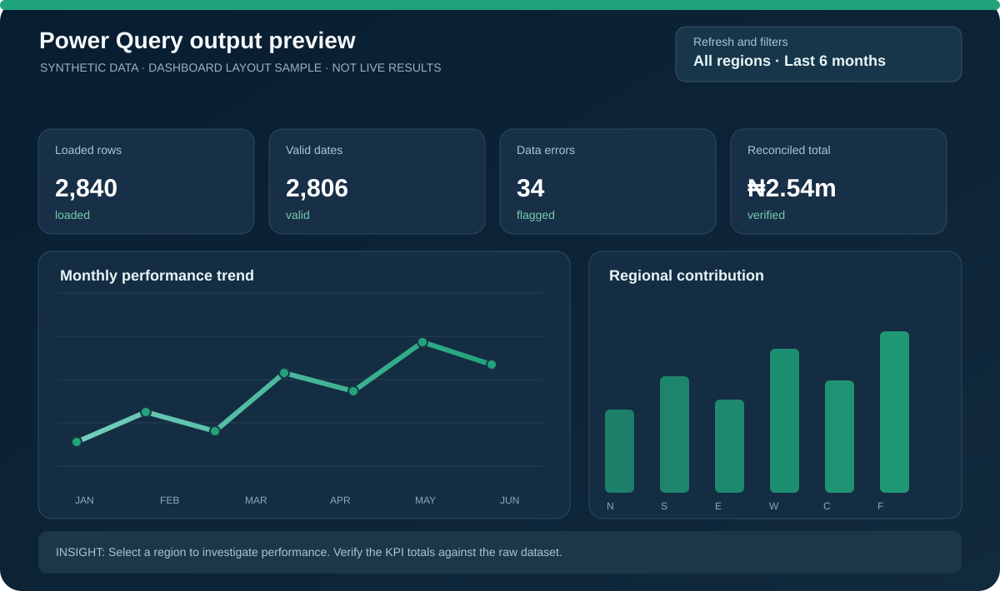

# Power Query · Week 08 · Grouping and reshaping dashboard-ready data

> DataLearning comprehensive practical lesson. Data is fictional. This worksheet supports the full in-app explanation and independent practice. Do not overwrite your raw source file.

## Learning outcome
Use Group By and Unpivot to produce tidy monthly KPI data for visual analytics.

## Where to begin in the tool
Choose Transform > Group By then Unpivot Columns where months are incorrectly stored as headers.


## Source data dictionary · exact practice file fields
The linked CSV uses these **exact header names**. Import the file before attempting examples. If an exercise uses a friendly or calculated name, map or create it first.

`order_id, order_date, region, category, quantity, unit_price_ngn, unit_cost_ngn, status, customer_id, channel`

Available `status` values: `Cancelled`, `Completed`, `Returned`

The worked example may introduce derived fields or example tables. Create or rename those fields explicitly and verify results against these original source columns. Source status values are Cancelled, Completed, Returned.

## Dataset and companion video
- **Download the dataset:** [`learning_sales_2026.csv`](../learning_sales_2026.csv)
- **Video companion:** https://www.youtube.com/watch?v=VO-MyVMKUC4 (the in-app Watch button opens the YouTube player when embedding is permitted).
- **Reading order:** first identify controls, then read the four concepts, reproduce the example, try an independent case, and validate your evidence.

## Explain the four essential concepts
### 1. Group By
returns one row per chosen category with sums or counts

### 2. Multiple aggregations
distinguish orders, revenue and distinct customer metrics

### 3. Unpivot
converts monthly columns into Month and Value rows

### 4. Tidy output
each field must have one well-defined meaning for charting.

## Why this skill matters
Why this skill matters: A Power BI developer needs a consistent fact table that supports month slicers and region charts. The method is not only about producing an attractive figure. Unpivot: converts monthly columns into Month and Value rows Tidy output: each field must have one well-defined meaning for charting. When preparing an output for another person, specify the reporting period, units, selection rules and known limitations. An analyst should be able to explain why a calculation or chart answers the actual business question and reproduce the result.

## Guided practice · follow all four steps
1. Open the correct workspace and identify the controls before entering commands. Choose Transform > Group By then Unpivot Columns where months are incorrectly stored as headers. Keep an untouched source or backup version so a mistake is reversible.
2. Apply the first two concepts on a small example: Group By — returns one row per chosen category with sums or counts Then test multiple aggregations with at least two contrasting inputs.
3. Reproduce the worked example below exactly, then change one input or filter. Explain which value changes and why. After that, apply unpivot and inspect the output for errors.
4. Complete the independent challenge: Make a long-format monthly revenue table and sketch a trend chart and regional KPI panel using it. Before moving on, check the result against the acceptance criteria: Summing the tidy output must reproduce the source figures; each Month value should be a valid period.

## Study this worked example
```text
Group by Region → Sum Revenue, Count Rows
Unpivot Jan,Feb,Mar columns → Month,Revenue rows
```

**How to interpret the output:** Grouping and reshaping dashboard-ready data begins with a practical objective: Use Group By and Unpivot to produce tidy monthly KPI data for visual analytics. In Power Query, begin by understanding the workspace and the data rather than memorising a command. Group By: returns one row per chosen category with sums or counts Multiple aggregations: distinguish orders, revenue and distinct customer metrics Practice these ideas on a small synthetic sample first. Notice where the tool shows inputs, intermediate results and errors; then describe in plain language what each operation does and what it does not prove. Keep original records separate from working calculations so you can trace any surprising result back to its source.

## Business case study
Business case: A Power BI developer needs a consistent fact table that supports month slicers and region charts. Your role is to deliver a result that a manager can trust and act upon, not merely a screenshot. First describe what records are included and excluded. Next perform the method described in this week, and record any changes to the source. Use the worked example as a starting point but test it with different values; finally communicate one relevant observation, one limitation and a follow-up.

## Independent practical challenge
Make a long-format monthly revenue table and sketch a trend chart and regional KPI panel using it.

**What you should hand in:** Summing the tidy output must reproduce the source figures; each Month value should be a valid period.

## Check your result (after attempting)
Expected evidence: Summing the tidy output must reproduce the source figures; each Month value should be a valid period. To validate it, compare a small hand-checked sample with the final output, test an alternative filter or a changed input, and record any unmatched, missing or suspicious data. If results differ, review the original data, formula or query, aggregation grain and selected filters before sharing the report. Avoid this common error: Reporting counts of rows as distinct orders in a dataset containing multiple lines per order.

**Common failure:** Reporting counts of rows as distinct orders in a dataset containing multiple lines per order.

## Reflect and explain the result
- Which menu, editor or pane did you use, and why?
- What is the data grain, metric definition or calculated rule?
- Can a second learner reproduce your output using the dataset and your instructions?
- Which number, chart or limitation must be mentioned when presenting your result?

## Dashboard design reference


Study the KPI strip, timeline, ranking, filters and notes. It is an illustrative wireframe, not a working dashboard or calculated analysis.

---
**Progress note:** Completing this worksheet is practice. Marking a week complete, passing an assessment and submitting an instructor-reviewed capstone are separate actions in DataLearning.
