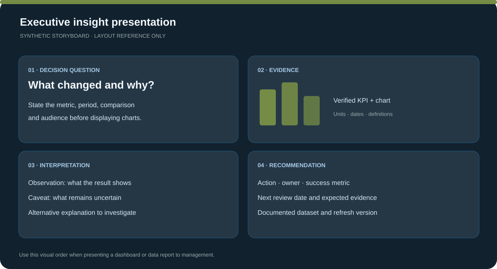

# Power Query · Week 09 · Reading M language and designing a refreshable pipeline

> DataLearning comprehensive practical lesson. Data is fictional. This worksheet supports the full in-app explanation and independent practice. Do not overwrite your raw source file.

## Learning outcome
Inspect Generated M steps, document dependencies and verify refresh without modifying original files.

## Where to begin in the tool
Use Home > Advanced Editor carefully, study let/in expressions, and record parameterised source paths.


## Source data dictionary · exact practice file fields
The linked CSV uses these **exact header names**. Import the file before attempting examples. If an exercise uses a friendly or calculated name, map or create it first.

`month, region, net_sales_ngn, sales_target_ngn, gross_profit_ngn, order_count, late_shipments, returned_orders`

The worked example may introduce derived fields or example tables. Create or rename those fields explicitly and verify results against these original source columns.

## Dataset and companion video
- **Download the dataset:** [`learning_monthly_kpis.csv`](../learning_monthly_kpis.csv)
- **Video companion:** https://www.youtube.com/watch?v=VO-MyVMKUC4 (the in-app Watch button opens the YouTube player when embedding is permitted).
- **Reading order:** first identify controls, then read the four concepts, reproduce the example, try an independent case, and validate your evidence.

## Explain the four essential concepts
### 1. M steps
transformations are expressions evaluated within let/in

### 2. Reuse
reference queries and parameters instead of copying the same source logic

### 3. Query folding
verify which transformations can push back to database sources

### 4. Refresh controls
check row counts, missing fields and credentials after updates.

## Why this skill matters
Why this skill matters: An analyst must hand over a monthly refresh process that another team member can operate. The method is not only about producing an attractive figure. Query folding: verify which transformations can push back to database sources Refresh controls: check row counts, missing fields and credentials after updates. When preparing an output for another person, specify the reporting period, units, selection rules and known limitations. An analyst should be able to explain why a calculation or chart answers the actual business question and reproduce the result.

## Guided practice · follow all four steps
1. Open the correct workspace and identify the controls before entering commands. Use Home > Advanced Editor carefully, study let/in expressions, and record parameterised source paths. Keep an untouched source or backup version so a mistake is reversible.
2. Apply the first two concepts on a small example: M steps — transformations are expressions evaluated within let/in Then test reuse with at least two contrasting inputs.
3. Reproduce the worked example below exactly, then change one input or filter. Explain which value changes and why. After that, apply query folding and inspect the output for errors.
4. Complete the independent challenge: Annotate a query's Source, Changed Type and Filtered Rows steps and create a refresh checklist for a colleague. Before moving on, check the result against the acceptance criteria: A fresh file of the same expected schema loads cleanly and the quality checks still reconcile.

## Study this worked example
```text
let Source = Csv.Document(File.Contents("sales.csv"),[Delimiter=","]),
    Promoted = Table.PromoteHeaders(Source,[PromoteAllScalars=true])
in Promoted
```

**How to interpret the output:** Reading M language and designing a refreshable pipeline begins with a practical objective: Inspect Generated M steps, document dependencies and verify refresh without modifying original files. In Power Query, begin by understanding the workspace and the data rather than memorising a command. M steps: transformations are expressions evaluated within let/in Reuse: reference queries and parameters instead of copying the same source logic Practice these ideas on a small synthetic sample first. Notice where the tool shows inputs, intermediate results and errors; then describe in plain language what each operation does and what it does not prove. Keep original records separate from working calculations so you can trace any surprising result back to its source.

## Business case study
Business case: An analyst must hand over a monthly refresh process that another team member can operate. Your role is to deliver a result that a manager can trust and act upon, not merely a screenshot. First describe what records are included and excluded. Next perform the method described in this week, and record any changes to the source. Use the worked example as a starting point but test it with different values; finally communicate one relevant observation, one limitation and a follow-up.

## Independent practical challenge
Annotate a query's Source, Changed Type and Filtered Rows steps and create a refresh checklist for a colleague.

**What you should hand in:** A fresh file of the same expected schema loads cleanly and the quality checks still reconcile.

## Check your result (after attempting)
Expected evidence: A fresh file of the same expected schema loads cleanly and the quality checks still reconcile. To validate it, compare a small hand-checked sample with the final output, test an alternative filter or a changed input, and record any unmatched, missing or suspicious data. If results differ, review the original data, formula or query, aggregation grain and selected filters before sharing the report. Avoid this common error: Assuming a query 'refreshed successfully' proves the business totals are correct.

**Common failure:** Assuming a query 'refreshed successfully' proves the business totals are correct.

## Reflect and explain the result
- Which menu, editor or pane did you use, and why?
- What is the data grain, metric definition or calculated rule?
- Can a second learner reproduce your output using the dataset and your instructions?
- Which number, chart or limitation must be mentioned when presenting your result?

## Management report presentation layout


Follow the order: decision question, verified evidence, interpretation and recommended action.

---
**Progress note:** Completing this worksheet is practice. Marking a week complete, passing an assessment and submitting an instructor-reviewed capstone are separate actions in DataLearning.
