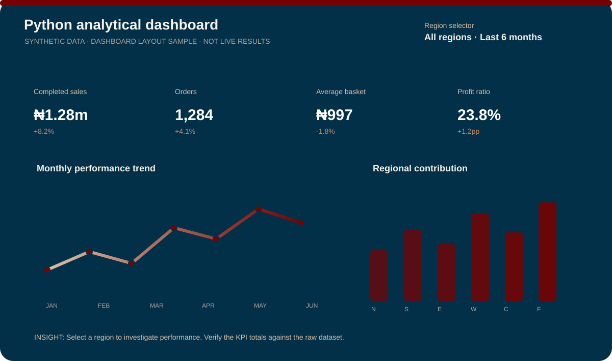

# Python and pandas · Week 08 · Building a Python dashboard or interactive report

> DataLearning comprehensive practical lesson. Data is fictional. This worksheet supports the full in-app explanation and independent practice. Do not overwrite your raw source file.

## Learning outcome
Compose KPIs and charts in a reproducible Streamlit or notebook dashboard layout.

## Where to begin in the tool
Sketch the dashboard grid, then use Streamlit st.metric, st.selectbox and chart objects in a local project if available.


## Source data dictionary · exact practice file fields
The linked CSV uses these **exact header names**. Import the file before attempting examples. If an exercise uses a friendly or calculated name, map or create it first.

`observation_id, delivery_minutes, basket_value_ngn, satisfaction_score, region, complaint_flag`

The worked example may introduce derived fields or example tables. Create or rename those fields explicitly and verify results against these original source columns.

## Dataset and companion video
- **Download the dataset:** [`learning_statistics_sample.csv`](../learning_statistics_sample.csv)
- **Video companion:** https://www.youtube.com/watch?v=GPVsHOlRBBI&t=8240s (the in-app Watch button opens the YouTube player when embedding is permitted).
- **Reading order:** first identify controls, then read the four concepts, reproduce the example, try an independent case, and validate your evidence.

## Explain the four essential concepts
### 1. Data pipeline
load and validate source before rendering

### 2. KPI layout
show Revenue, Orders and AOV in a consistent row

### 3. Interaction
user controls should filter both chart and headline metrics

### 4. Deployment distinction
local Streamlit requires an installed runtime and separate hosting for public access.

## Why this skill matters
Why this skill matters: A marketing team needs a compact self-service dashboard that explains recent sales results. The method is not only about producing an attractive figure. Interaction: user controls should filter both chart and headline metrics Deployment distinction: local Streamlit requires an installed runtime and separate hosting for public access. When preparing an output for another person, specify the reporting period, units, selection rules and known limitations. An analyst should be able to explain why a calculation or chart answers the actual business question and reproduce the result.

## Guided practice · follow all four steps
1. Open the correct workspace and identify the controls before entering commands. Sketch the dashboard grid, then use Streamlit st.metric, st.selectbox and chart objects in a local project if available. Keep an untouched source or backup version so a mistake is reversible.
2. Apply the first two concepts on a small example: Data pipeline — load and validate source before rendering Then test kpi layout with at least two contrasting inputs.
3. Reproduce the worked example below exactly, then change one input or filter. Explain which value changes and why. After that, apply interaction and inspect the output for errors.
4. Complete the independent challenge: Sketch and implement a dashboard with two charts and at least three KPIs, or produce a notebook report where Streamlit is unavailable. Before moving on, check the result against the acceptance criteria: A region selection must change all linked metrics; the source revenue total is the independent accuracy check.

## Study this worked example
```text
import streamlit as st
import pandas as pd
df=pd.read_csv('learning_statistics_sample.csv')
st.title('Basket and delivery dashboard')
st.metric('Observations',len(df))
st.metric('Median basket',f"₦{df['basket_value_ngn'].median():,.0f}")
st.bar_chart(df.groupby('region')['basket_value_ngn'].mean())
```

**How to interpret the output:** Building a Python dashboard or interactive report begins with a practical objective: Compose KPIs and charts in a reproducible Streamlit or notebook dashboard layout. In Python and pandas, begin by understanding the workspace and the data rather than memorising a command. Data pipeline: load and validate source before rendering KPI layout: show Revenue, Orders and AOV in a consistent row Practice these ideas on a small synthetic sample first. Notice where the tool shows inputs, intermediate results and errors; then describe in plain language what each operation does and what it does not prove. Keep original records separate from working calculations so you can trace any surprising result back to its source.

## Business case study
Business case: A marketing team needs a compact self-service dashboard that explains recent sales results. Your role is to deliver a result that a manager can trust and act upon, not merely a screenshot. First describe what records are included and excluded. Next perform the method described in this week, and record any changes to the source. Use the worked example as a starting point but test it with different values; finally communicate one relevant observation, one limitation and a follow-up.

## Independent practical challenge
Sketch and implement a dashboard with two charts and at least three KPIs, or produce a notebook report where Streamlit is unavailable.

**What you should hand in:** A region selection must change all linked metrics; the source revenue total is the independent accuracy check.

## Check your result (after attempting)
Expected evidence: A region selection must change all linked metrics; the source revenue total is the independent accuracy check. To validate it, compare a small hand-checked sample with the final output, test an alternative filter or a changed input, and record any unmatched, missing or suspicious data. If results differ, review the original data, formula or query, aggregation grain and selected filters before sharing the report. Avoid this common error: Assuming a notebook becomes a public web app automatically or displaying numbers without sources.

**Common failure:** Assuming a notebook becomes a public web app automatically or displaying numbers without sources.

## Reflect and explain the result
- Which menu, editor or pane did you use, and why?
- What is the data grain, metric definition or calculated rule?
- Can a second learner reproduce your output using the dataset and your instructions?
- Which number, chart or limitation must be mentioned when presenting your result?

## Dashboard design reference


Study the KPI strip, timeline, ranking, filters and notes. It is an illustrative wireframe, not a working dashboard or calculated analysis.

---
**Progress note:** Completing this worksheet is practice. Marking a week complete, passing an assessment and submitting an instructor-reviewed capstone are separate actions in DataLearning.
