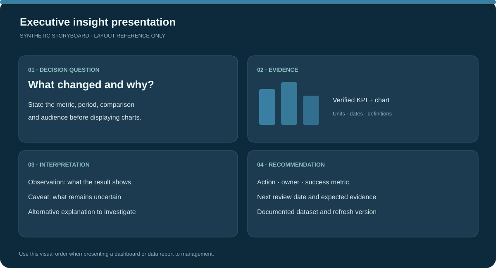

# Python and pandas · Week 09 · Automating reporting and presenting Python insights

> DataLearning comprehensive practical lesson. Data is fictional. This worksheet supports the full in-app explanation and independent practice. Do not overwrite your raw source file.

## Learning outcome
Export clean tables, plots and a reproducible analysis narrative for business stakeholders.

## Where to begin in the tool
Use pandas to_csv, matplotlib savefig and a notebook Markdown executive summary.


## Source data dictionary · exact practice file fields
The linked CSV uses these **exact header names**. Import the file before attempting examples. If an exercise uses a friendly or calculated name, map or create it first.

`month, net_sales_ngn, orders`

The worked example may introduce derived fields or example tables. Create or rename those fields explicitly and verify results against these original source columns.

## Dataset and companion video
- **Download the dataset:** [`learning_forecast_series.csv`](../learning_forecast_series.csv)
- **Video companion:** https://www.youtube.com/watch?v=GPVsHOlRBBI&t=21168s (the in-app Watch button opens the YouTube player when embedding is permitted).
- **Reading order:** first identify controls, then read the four concepts, reproduce the example, try an independent case, and validate your evidence.

## Explain the four essential concepts
### 1. Outputs
write datasets and figures to an outputs folder rather than overwriting raw inputs

### 2. Reporting
state question, data period, KPI definitions and evidence

### 3. Automation
parameterise file paths and dates before scheduling

### 4. Reliability
re-run the analysis from a fresh environment to catch hidden notebook state.

## Why this skill matters
Why this skill matters: A department head wants monthly analytical results that another analyst can reproduce without assistance. The method is not only about producing an attractive figure. Automation: parameterise file paths and dates before scheduling Reliability: re-run the analysis from a fresh environment to catch hidden notebook state. When preparing an output for another person, specify the reporting period, units, selection rules and known limitations. An analyst should be able to explain why a calculation or chart answers the actual business question and reproduce the result.

## Guided practice · follow all four steps
1. Open the correct workspace and identify the controls before entering commands. Use pandas to_csv, matplotlib savefig and a notebook Markdown executive summary. Keep an untouched source or backup version so a mistake is reversible.
2. Apply the first two concepts on a small example: Outputs — write datasets and figures to an outputs folder rather than overwriting raw inputs Then test reporting with at least two contrasting inputs.
3. Reproduce the worked example below exactly, then change one input or filter. Explain which value changes and why. After that, apply automation and inspect the output for errors.
4. Complete the independent challenge: Generate an exported KPI table and chart plus a 150-word management briefing with two recommendations. Before moving on, check the result against the acceptance criteria: The exported totals equal those calculated in memory; the report names its source and reporting period.

## Study this worked example
```text
from pathlib import Path
import pandas as pd
import matplotlib.pyplot as plt
Path('outputs').mkdir(exist_ok=True)
series=pd.read_csv('learning_forecast_series.csv')
series.to_csv('outputs/checked_forecast_input.csv',index=False)
fig,ax=plt.subplots()
ax.plot(series['month'],series['net_sales_ngn'])
ax.set(title='Sales trend',xlabel='Month',ylabel='Net sales (₦)')
fig.autofmt_xdate()
fig.savefig('outputs/sales_trend.png',dpi=160,bbox_inches='tight')
```

**How to interpret the output:** Automating reporting and presenting Python insights begins with a practical objective: Export clean tables, plots and a reproducible analysis narrative for business stakeholders. In Python and pandas, begin by understanding the workspace and the data rather than memorising a command. Outputs: write datasets and figures to an outputs folder rather than overwriting raw inputs Reporting: state question, data period, KPI definitions and evidence Practice these ideas on a small synthetic sample first. Notice where the tool shows inputs, intermediate results and errors; then describe in plain language what each operation does and what it does not prove. Keep original records separate from working calculations so you can trace any surprising result back to its source.

## Business case study
Business case: A department head wants monthly analytical results that another analyst can reproduce without assistance. Your role is to deliver a result that a manager can trust and act upon, not merely a screenshot. First describe what records are included and excluded. Next perform the method described in this week, and record any changes to the source. Use the worked example as a starting point but test it with different values; finally communicate one relevant observation, one limitation and a follow-up.

## Independent practical challenge
Generate an exported KPI table and chart plus a 150-word management briefing with two recommendations.

**What you should hand in:** The exported totals equal those calculated in memory; the report names its source and reporting period.

## Check your result (after attempting)
Expected evidence: The exported totals equal those calculated in memory; the report names its source and reporting period. To validate it, compare a small hand-checked sample with the final output, test an alternative filter or a changed input, and record any unmatched, missing or suspicious data. If results differ, review the original data, formula or query, aggregation grain and selected filters before sharing the report. Avoid this common error: Sharing a notebook that only runs due to hidden variables from earlier interactive sessions.

**Common failure:** Sharing a notebook that only runs due to hidden variables from earlier interactive sessions.

## Reflect and explain the result
- Which menu, editor or pane did you use, and why?
- What is the data grain, metric definition or calculated rule?
- Can a second learner reproduce your output using the dataset and your instructions?
- Which number, chart or limitation must be mentioned when presenting your result?

## Management report presentation layout


Follow the order: decision question, verified evidence, interpretation and recommended action.

---
**Progress note:** Completing this worksheet is practice. Marking a week complete, passing an assessment and submitting an instructor-reviewed capstone are separate actions in DataLearning.
