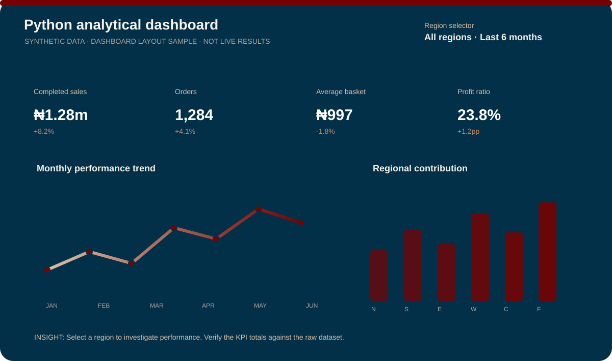
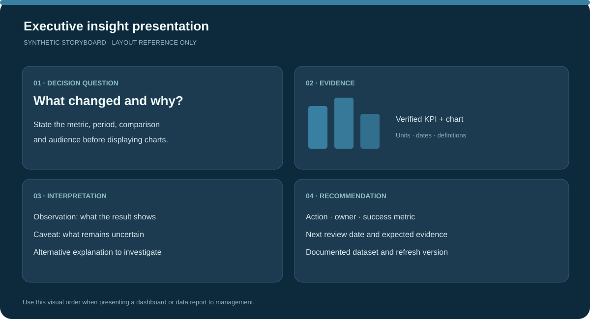

# Python and pandas · Week 10 · Python capstone: raw CSV to dashboard and report

> DataLearning comprehensive practical lesson. Data is fictional. This worksheet supports the full in-app explanation and independent practice. Do not overwrite your raw source file.

## Learning outcome
Build a full data analysis project from source ingestion through dashboard, validated insights and presentation.

## Where to begin in the tool
Create project folders for data, notebooks or scripts, outputs and README before running the first transformation.


## Source data dictionary · exact practice file fields
The linked CSV uses these **exact header names**. Import the file before attempting examples. If an exercise uses a friendly or calculated name, map or create it first.

`order_id, order_date, customer_id, customer, region, product_id, product, quantity, unit_price, unit_cost, status, channel`

Available `status` values: `Completed`, `Returned`

The worked example may introduce derived fields or example tables. Create or rename those fields explicitly and verify results against these original source columns. Source status values are Completed, Returned.

## Dataset and companion video
- **Download the dataset:** [`mastery_orders.csv`](../mastery_orders.csv)
- **Video companion:** https://www.youtube.com/watch?v=GPVsHOlRBBI&t=28196s (the in-app Watch button opens the YouTube player when embedding is permitted).
- **Reading order:** first identify controls, then read the four concepts, reproduce the example, try an independent case, and validate your evidence.

## Explain the four essential concepts
### 1. Workflow
load a raw dataset and document assumptions

### 2. Quality and KPIs
clean records, group data and reconcile totals

### 3. Visual deliverable
publish plots and a dashboard or self-contained notebook narrative

### 4. Project evidence
supply code or notebook, exported charts, conclusions and instructions.

## Why this skill matters
Why this skill matters: A fictional retailer wants a reproducible Python analysis that can inform weekly sales and inventory decisions. The method is not only about producing an attractive figure. Visual deliverable: publish plots and a dashboard or self-contained notebook narrative Project evidence: supply code or notebook, exported charts, conclusions and instructions. When preparing an output for another person, specify the reporting period, units, selection rules and known limitations. An analyst should be able to explain why a calculation or chart answers the actual business question and reproduce the result.

## Guided practice · follow all four steps
1. Open the correct workspace and identify the controls before entering commands. Create project folders for data, notebooks or scripts, outputs and README before running the first transformation. Keep an untouched source or backup version so a mistake is reversible.
2. Apply the first two concepts on a small example: Workflow — load a raw dataset and document assumptions Then test quality and kpis with at least two contrasting inputs.
3. Reproduce the worked example below exactly, then change one input or filter. Explain which value changes and why. After that, apply visual deliverable and inspect the output for errors.
4. Complete the independent challenge: Submit an executable notebook/script, two meaningful charts, a dashboard mock or screenshot, a short report and validation notes. Before moving on, check the result against the acceptance criteria: An instructor can reproduce your summary from the supplied dataset; submission should disclose versions and limitations.

## Study this worked example
```text
Deliverables: analysis.ipynb or analysis.py, screenshots, report.pdf or README
Checks: raw vs cleaned row counts; summed revenue; plot period validity
```

**How to interpret the output:** Python capstone: raw CSV to dashboard and report begins with a practical objective: Build a full data analysis project from source ingestion through dashboard, validated insights and presentation. In Python and pandas, begin by understanding the workspace and the data rather than memorising a command. Workflow: load a raw dataset and document assumptions Quality and KPIs: clean records, group data and reconcile totals Practice these ideas on a small synthetic sample first. Notice where the tool shows inputs, intermediate results and errors; then describe in plain language what each operation does and what it does not prove. Keep original records separate from working calculations so you can trace any surprising result back to its source.

## Business case study
Business case: A fictional retailer wants a reproducible Python analysis that can inform weekly sales and inventory decisions. Your role is to deliver a result that a manager can trust and act upon, not merely a screenshot. First describe what records are included and excluded. Next perform the method described in this week, and record any changes to the source. Use the worked example as a starting point but test it with different values; finally communicate one relevant observation, one limitation and a follow-up.

## Independent practical challenge
Submit an executable notebook/script, two meaningful charts, a dashboard mock or screenshot, a short report and validation notes.

**What you should hand in:** An instructor can reproduce your summary from the supplied dataset; submission should disclose versions and limitations.

## Check your result (after attempting)
Expected evidence: An instructor can reproduce your summary from the supplied dataset; submission should disclose versions and limitations. To validate it, compare a small hand-checked sample with the final output, test an alternative filter or a changed input, and record any unmatched, missing or suspicious data. If results differ, review the original data, formula or query, aggregation grain and selected filters before sharing the report. Avoid this common error: Submitting code screenshots without a runnable project or incorrectly describing a forecast as a fact.

**Common failure:** Submitting code screenshots without a runnable project or incorrectly describing a forecast as a fact.

## Reflect and explain the result
- Which menu, editor or pane did you use, and why?
- What is the data grain, metric definition or calculated rule?
- Can a second learner reproduce your output using the dataset and your instructions?
- Which number, chart or limitation must be mentioned when presenting your result?

## Dashboard design reference


Study the KPI strip, timeline, ranking, filters and notes. It is an illustrative wireframe, not a working dashboard or calculated analysis.

## Management report presentation layout


Follow the order: decision question, verified evidence, interpretation and recommended action.

## Final Capstone Project · required note
You have reached Week 10. Complete a reproducible end-to-end analysis and submit evidence for your instructor to review. Identify the audience and business question; document the source, cleaning, transformations and checks; present useful visuals and findings; and write recommendations with limitations.

**Submission:** [Open your Python and pandas capstone submission page](../../capstone.html?course=python). Sign in and synchronise all ten completed weeks before uploading. Attach your native project file and readable dashboard/report screenshots (up to four files; 12 MB per file, 32 MB total).

**Rubric (100 points):** problem/objectives 25, data quality 20, technical implementation 20, evidence-based findings 20, communication/evidence 15. An instructor reviews each submission; 70/100 is the pass threshold. Never upload personal or confidential business information.

---
**Progress note:** Completing this worksheet is practice. Marking a week complete, passing an assessment and submitting an instructor-reviewed capstone are separate actions in DataLearning.
