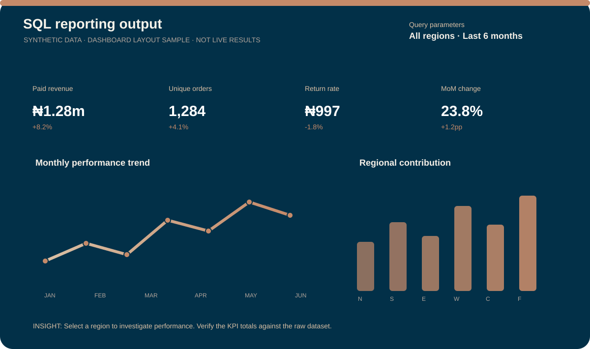

# SQL and SQLite · Week 08 · Building dashboard-ready SQL datasets

> DataLearning comprehensive practical lesson. Data is fictional. This worksheet supports the full in-app explanation and independent practice. Do not overwrite your raw source file.

## Learning outcome
Shape a query output that a BI tool can visualise without ambiguity.

## Where to begin in the tool
Use CTEs to prepare a dataset with one row per month and region and explicit measure fields.


## Source data dictionary · exact practice file fields
The SQL database contains the following **real tables and columns**. Use these names in your queries rather than assuming fields that do not exist.

- `customers (customer_id, customer_name, segment, region, signup_date)`
- `orders (order_id, order_date, customer_id, region, category, product, quantity, unit_price, unit_cost, discount_pct, status, sales_rep)`
- `targets (month_start, region, sales_target)`

Available `status` values: `Completed`, `Returned`, `Cancelled`

The worked example may introduce derived fields or example tables. Create or rename those fields explicitly and verify results against these original source columns. Source status values are Completed, Returned, Cancelled.

## Dataset and companion video
- **Download the dataset:** [`retail_practice.sqlite`](../retail_practice.sqlite)
- **Video companion:** https://www.youtube.com/watch?v=PSNXoAs2FtQ&t=8217s (the in-app Watch button opens the YouTube player when embedding is permitted).
- **Reading order:** first identify controls, then read the four concepts, reproduce the example, try an independent case, and validate your evidence.

## Explain the four essential concepts
### 1. Reporting grain
declare one row per Month x Region in documentation

### 2. KPI fields
pre-aggregate completed revenue, order count and return rate consistently

### 3. Dates
normalise to reporting month and preserve original timestamps

### 4. Source checks
include row counts, unmatched keys and excluded statuses as validation outputs.

## Why this skill matters
Why this skill matters: A Power BI team needs a trustworthy monthly fact table to build a management dashboard. The method is not only about producing an attractive figure. Dates: normalise to reporting month and preserve original timestamps Source checks: include row counts, unmatched keys and excluded statuses as validation outputs. When preparing an output for another person, specify the reporting period, units, selection rules and known limitations. An analyst should be able to explain why a calculation or chart answers the actual business question and reproduce the result.

## Guided practice · follow all four steps
1. Open the correct workspace and identify the controls before entering commands. Use CTEs to prepare a dataset with one row per month and region and explicit measure fields. Keep an untouched source or backup version so a mistake is reversible.
2. Apply the first two concepts on a small example: Reporting grain — declare one row per Month x Region in documentation Then test kpi fields with at least two contrasting inputs.
3. Reproduce the worked example below exactly, then change one input or filter. Explain which value changes and why. After that, apply dates and inspect the output for errors.
4. Complete the independent challenge: Produce a tidy reporting view for a trend chart and a region filter; sketch a dashboard layout fed by this output. Before moving on, check the result against the acceptance criteria: Every row represents one month-region combination; when grouped again by month, totals must reconcile.

## Study this worked example
```text
SELECT substr(order_date,1,7) AS month,region,
ROUND(SUM(quantity*unit_price*(1-discount_pct)),2) AS completed_revenue,
COUNT(DISTINCT order_id) AS order_count
FROM orders WHERE status='Completed'
GROUP BY substr(order_date,1,7),region ORDER BY month,region;
```

**How to interpret the output:** Building dashboard-ready SQL datasets begins with a practical objective: Shape a query output that a BI tool can visualise without ambiguity. In SQL and SQLite, begin by understanding the workspace and the data rather than memorising a command. Reporting grain: declare one row per Month x Region in documentation KPI fields: pre-aggregate completed revenue, order count and return rate consistently Practice these ideas on a small synthetic sample first. Notice where the tool shows inputs, intermediate results and errors; then describe in plain language what each operation does and what it does not prove. Keep original records separate from working calculations so you can trace any surprising result back to its source.

## Business case study
Business case: A Power BI team needs a trustworthy monthly fact table to build a management dashboard. Your role is to deliver a result that a manager can trust and act upon, not merely a screenshot. First describe what records are included and excluded. Next perform the method described in this week, and record any changes to the source. Use the worked example as a starting point but test it with different values; finally communicate one relevant observation, one limitation and a follow-up.

## Independent practical challenge
Produce a tidy reporting view for a trend chart and a region filter; sketch a dashboard layout fed by this output.

**What you should hand in:** Every row represents one month-region combination; when grouped again by month, totals must reconcile.

## Check your result (after attempting)
Expected evidence: Every row represents one month-region combination; when grouped again by month, totals must reconcile. To validate it, compare a small hand-checked sample with the final output, test an alternative filter or a changed input, and record any unmatched, missing or suspicious data. If results differ, review the original data, formula or query, aggregation grain and selected filters before sharing the report. Avoid this common error: Using SELECT * as a long-term reporting schema or mixing gross and completed revenue definitions.

**Common failure:** Using SELECT * as a long-term reporting schema or mixing gross and completed revenue definitions.

## Reflect and explain the result
- Which menu, editor or pane did you use, and why?
- What is the data grain, metric definition or calculated rule?
- Can a second learner reproduce your output using the dataset and your instructions?
- Which number, chart or limitation must be mentioned when presenting your result?

## Dashboard design reference


Study the KPI strip, timeline, ranking, filters and notes. It is an illustrative wireframe, not a working dashboard or calculated analysis.

---
**Progress note:** Completing this worksheet is practice. Marking a week complete, passing an assessment and submitting an instructor-reviewed capstone are separate actions in DataLearning.
