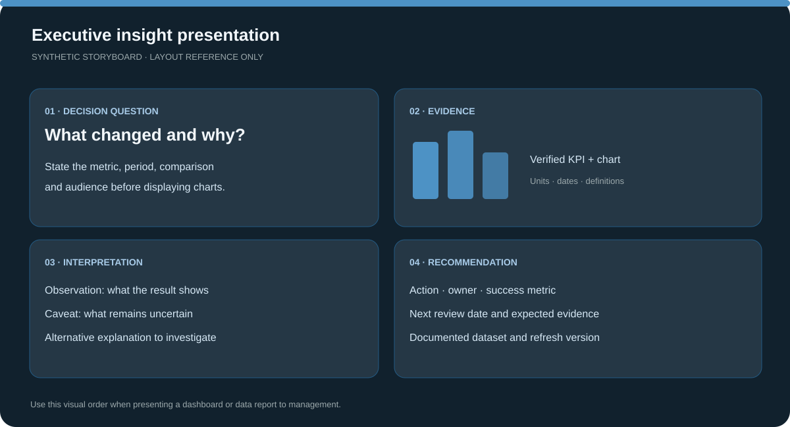

# SQL and SQLite · Week 09 · Optimising, validating and presenting SQL analysis

> DataLearning comprehensive practical lesson. Data is fictional. This worksheet supports the full in-app explanation and independent practice. Do not overwrite your raw source file.

## Learning outcome
Explain query results to decision-makers and prepare reproducible validation evidence.

## Where to begin in the tool
Use EXPLAIN QUERY PLAN where supported, compare rows scanned and keep an audited final SELECT.


## Source data dictionary · exact practice file fields
The SQL database contains the following **real tables and columns**. Use these names in your queries rather than assuming fields that do not exist.

- `customers (customer_id, customer_name, segment, region, signup_date)`
- `orders (order_id, order_date, customer_id, region, category, product, quantity, unit_price, unit_cost, discount_pct, status, sales_rep)`
- `targets (month_start, region, sales_target)`

Available `status` values: `Completed`, `Returned`, `Cancelled`

The worked example may introduce derived fields or example tables. Create or rename those fields explicitly and verify results against these original source columns. Source status values are Completed, Returned, Cancelled.

## Dataset and companion video
- **Download the dataset:** [`retail_practice.sqlite`](../retail_practice.sqlite)
- **Video companion:** https://www.youtube.com/watch?v=PSNXoAs2FtQ&t=7795s (the in-app Watch button opens the YouTube player when embedding is permitted).
- **Reading order:** first identify controls, then read the four concepts, reproduce the example, try an independent case, and validate your evidence.

## Explain the four essential concepts
### 1. Indexes
can improve search and join performance where predicates match access paths

### 2. Filtering
restrict data early when the logic allows it

### 3. Reconciliation
compare base counts and sums against final query output

### 4. Communication
supply query, data dictionary, report-ready result and three evidence-based insights.

## Why this skill matters
Why this skill matters: An analytics lead reviews the correctness and maintainability of a monthly revenue extract before distribution. The method is not only about producing an attractive figure. Reconciliation: compare base counts and sums against final query output Communication: supply query, data dictionary, report-ready result and three evidence-based insights. When preparing an output for another person, specify the reporting period, units, selection rules and known limitations. An analyst should be able to explain why a calculation or chart answers the actual business question and reproduce the result.

## Guided practice · follow all four steps
1. Open the correct workspace and identify the controls before entering commands. Use EXPLAIN QUERY PLAN where supported, compare rows scanned and keep an audited final SELECT. Keep an untouched source or backup version so a mistake is reversible.
2. Apply the first two concepts on a small example: Indexes — can improve search and join performance where predicates match access paths Then test filtering with at least two contrasting inputs.
3. Reproduce the worked example below exactly, then change one input or filter. Explain which value changes and why. After that, apply reconciliation and inspect the output for errors.
4. Complete the independent challenge: Prepare a concise SQL reporting note with query logic, total checks, performance observation and one recommended follow-up. Before moving on, check the result against the acceptance criteria: Base and final totals reconcile at the same grain; query improvement must not change the answer.

## Study this worked example
```text
SELECT COUNT(*) AS rows,
ROUND(SUM(quantity*unit_price*(1-discount_pct)),2) AS net_revenue
FROM orders WHERE status='Completed';
EXPLAIN QUERY PLAN SELECT * FROM orders WHERE order_id='O0001';
```

**How to interpret the output:** Optimising, validating and presenting SQL analysis begins with a practical objective: Explain query results to decision-makers and prepare reproducible validation evidence. In SQL and SQLite, begin by understanding the workspace and the data rather than memorising a command. Indexes: can improve search and join performance where predicates match access paths Filtering: restrict data early when the logic allows it Practice these ideas on a small synthetic sample first. Notice where the tool shows inputs, intermediate results and errors; then describe in plain language what each operation does and what it does not prove. Keep original records separate from working calculations so you can trace any surprising result back to its source.

## Business case study
Business case: An analytics lead reviews the correctness and maintainability of a monthly revenue extract before distribution. Your role is to deliver a result that a manager can trust and act upon, not merely a screenshot. First describe what records are included and excluded. Next perform the method described in this week, and record any changes to the source. Use the worked example as a starting point but test it with different values; finally communicate one relevant observation, one limitation and a follow-up.

## Independent practical challenge
Prepare a concise SQL reporting note with query logic, total checks, performance observation and one recommended follow-up.

**What you should hand in:** Base and final totals reconcile at the same grain; query improvement must not change the answer.

## Check your result (after attempting)
Expected evidence: Base and final totals reconcile at the same grain; query improvement must not change the answer. To validate it, compare a small hand-checked sample with the final output, test an alternative filter or a changed input, and record any unmatched, missing or suspicious data. If results differ, review the original data, formula or query, aggregation grain and selected filters before sharing the report. Avoid this common error: Optimising only for speed while introducing incorrect joins or removing necessary records.

**Common failure:** Optimising only for speed while introducing incorrect joins or removing necessary records.

## Reflect and explain the result
- Which menu, editor or pane did you use, and why?
- What is the data grain, metric definition or calculated rule?
- Can a second learner reproduce your output using the dataset and your instructions?
- Which number, chart or limitation must be mentioned when presenting your result?

## Management report presentation layout


Follow the order: decision question, verified evidence, interpretation and recommended action.

---
**Progress note:** Completing this worksheet is practice. Marking a week complete, passing an assessment and submitting an instructor-reviewed capstone are separate actions in DataLearning.
