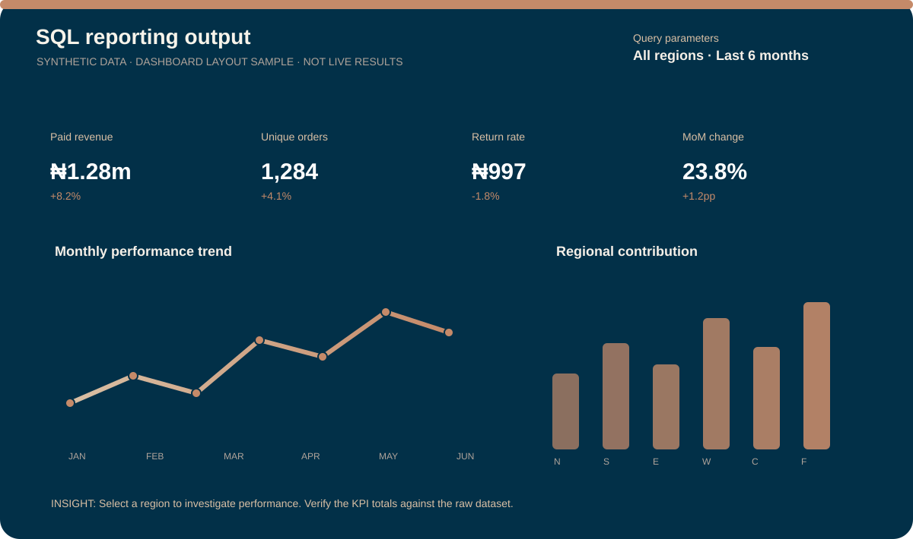
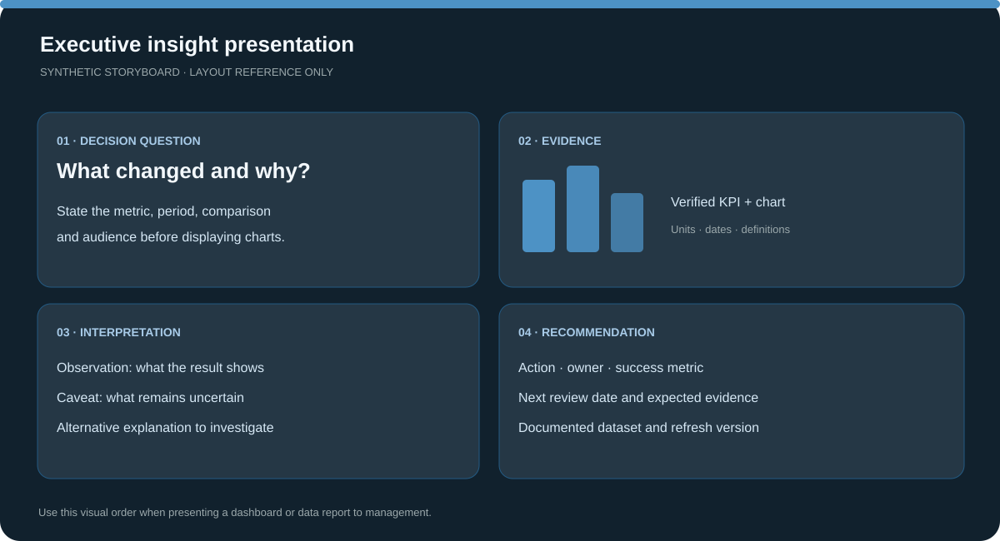

# SQL and SQLite · Week 10 · SQL capstone: end-to-end analytical reporting dataset

> DataLearning comprehensive practical lesson. Data is fictional. This worksheet supports the full in-app explanation and independent practice. Do not overwrite your raw source file.

## Learning outcome
Design, test and submit a repeatable SQL project for a complete business question.

## Where to begin in the tool
Start from the supplied SQLite database; inspect tables and document their keys and the reporting grain.


## Source data dictionary · exact practice file fields
The SQL database contains the following **real tables and columns**. Use these names in your queries rather than assuming fields that do not exist.

- `customers (customer_id, customer_name, segment, region, signup_date)`
- `orders (order_id, order_date, customer_id, region, category, product, quantity, unit_price, unit_cost, discount_pct, status, sales_rep)`
- `targets (month_start, region, sales_target)`

Available `status` values: `Completed`, `Returned`, `Cancelled`

The worked example may introduce derived fields or example tables. Create or rename those fields explicitly and verify results against these original source columns. Source status values are Completed, Returned, Cancelled.

## Dataset and companion video
- **Download the dataset:** [`retail_practice.sqlite`](../retail_practice.sqlite)
- **Video companion:** https://www.youtube.com/watch?v=PSNXoAs2FtQ&t=8209s (the in-app Watch button opens the YouTube player when embedding is permitted).
- **Reading order:** first identify controls, then read the four concepts, reproduce the example, try an independent case, and validate your evidence.

## Explain the four essential concepts
### 1. Database review
document source columns, business rules and identifiers

### 2. Analytical queries
demonstrate filters, joins, aggregations, CTE and a window function

### 3. Dashboard handoff
export a tidy results table and illustrate suitable KPIs and charts

### 4. Verification
record count, revenue reconciliation, missing joins and query assumptions.

## Why this skill matters
Why this skill matters: A fictional retail chain requests a validated dataset and concise management insight pack from its transactional database. The method is not only about producing an attractive figure. Dashboard handoff: export a tidy results table and illustrate suitable KPIs and charts Verification: record count, revenue reconciliation, missing joins and query assumptions. When preparing an output for another person, specify the reporting period, units, selection rules and known limitations. An analyst should be able to explain why a calculation or chart answers the actual business question and reproduce the result.

## Guided practice · follow all four steps
1. Open the correct workspace and identify the controls before entering commands. Start from the supplied SQLite database; inspect tables and document their keys and the reporting grain. Keep an untouched source or backup version so a mistake is reversible.
2. Apply the first two concepts on a small example: Database review — document source columns, business rules and identifiers Then test analytical queries with at least two contrasting inputs.
3. Reproduce the worked example below exactly, then change one input or filter. Explain which value changes and why. After that, apply dashboard handoff and inspect the output for errors.
4. Complete the independent challenge: Submit the SQL script, exported reporting dataset, validation notes and a dashboard mockup or results presentation. Before moving on, check the result against the acceptance criteria: An independent reviewer should rerun the SELECT queries and reproduce your metrics; provide screenshots of the editor and output.

## Study this worked example
```text
Deliverables: .sql file containing queries + exported CSV
KPI controls: completed total, distinct orders, return count, MoM delta
```

**How to interpret the output:** SQL capstone: end-to-end analytical reporting dataset begins with a practical objective: Design, test and submit a repeatable SQL project for a complete business question. In SQL and SQLite, begin by understanding the workspace and the data rather than memorising a command. Database review: document source columns, business rules and identifiers Analytical queries: demonstrate filters, joins, aggregations, CTE and a window function Practice these ideas on a small synthetic sample first. Notice where the tool shows inputs, intermediate results and errors; then describe in plain language what each operation does and what it does not prove. Keep original records separate from working calculations so you can trace any surprising result back to its source.

## Business case study
Business case: A fictional retail chain requests a validated dataset and concise management insight pack from its transactional database. Your role is to deliver a result that a manager can trust and act upon, not merely a screenshot. First describe what records are included and excluded. Next perform the method described in this week, and record any changes to the source. Use the worked example as a starting point but test it with different values; finally communicate one relevant observation, one limitation and a follow-up.

## Independent practical challenge
Submit the SQL script, exported reporting dataset, validation notes and a dashboard mockup or results presentation.

**What you should hand in:** An independent reviewer should rerun the SELECT queries and reproduce your metrics; provide screenshots of the editor and output.

## Check your result (after attempting)
Expected evidence: An independent reviewer should rerun the SELECT queries and reproduce your metrics; provide screenshots of the editor and output. To validate it, compare a small hand-checked sample with the final output, test an alternative filter or a changed input, and record any unmatched, missing or suspicious data. If results differ, review the original data, formula or query, aggregation grain and selected filters before sharing the report. Avoid this common error: Submitting only code with no analysis, no schema, no evidence and no conclusion.

**Common failure:** Submitting only code with no analysis, no schema, no evidence and no conclusion.

## Reflect and explain the result
- Which menu, editor or pane did you use, and why?
- What is the data grain, metric definition or calculated rule?
- Can a second learner reproduce your output using the dataset and your instructions?
- Which number, chart or limitation must be mentioned when presenting your result?

## Dashboard design reference


Study the KPI strip, timeline, ranking, filters and notes. It is an illustrative wireframe, not a working dashboard or calculated analysis.

## Management report presentation layout


Follow the order: decision question, verified evidence, interpretation and recommended action.

## Final Capstone Project · required note
You have reached Week 10. Complete a reproducible end-to-end analysis and submit evidence for your instructor to review. Identify the audience and business question; document the source, cleaning, transformations and checks; present useful visuals and findings; and write recommendations with limitations.

**Submission:** [Open your SQL and SQLite capstone submission page](../../capstone.html?course=sql). Sign in and synchronise all ten completed weeks before uploading. Attach your native project file and readable dashboard/report screenshots (up to four files; 12 MB per file, 32 MB total).

**Rubric (100 points):** problem/objectives 25, data quality 20, technical implementation 20, evidence-based findings 20, communication/evidence 15. An instructor reviews each submission; 70/100 is the pass threshold. Never upload personal or confidential business information.

---
**Progress note:** Completing this worksheet is practice. Marking a week complete, passing an assessment and submitting an instructor-reviewed capstone are separate actions in DataLearning.
