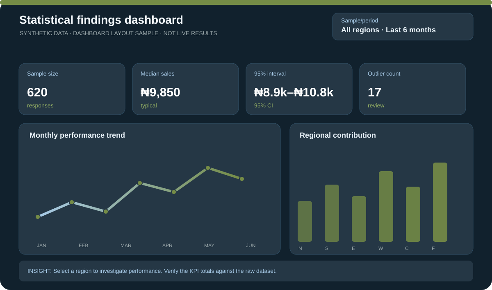

# Applied Statistics · Week 08 · Confidence intervals and uncertainty dashboard

> DataLearning comprehensive practical lesson. Data is fictional. This worksheet supports the full in-app explanation and independent practice. Do not overwrite your raw source file.

## Learning outcome
Construct and interpret a confidence interval in business terms without overstating certainty.

## Where to begin in the tool
Use a sample proportion and its standard error, or statistical software with clearly stated assumptions.


## Source data dictionary · exact practice file fields
The linked CSV uses these **exact header names**. Import the file before attempting examples. If an exercise uses a friendly or calculated name, map or create it first.

`session_id, variant, converted, device, region, basket_items`

The worked example may introduce derived fields or example tables. Create or rename those fields explicitly and verify results against these original source columns.

## Dataset and companion video
- **Download the dataset:** [`learning_experiment.csv`](../learning_experiment.csv)
- **Video companion:** https://www.youtube.com/watch?v=bS2Tmxpc0mw (the in-app Watch button opens the YouTube player when embedding is permitted).
- **Reading order:** first identify controls, then read the four concepts, reproduce the example, try an independent case, and validate your evidence.

## Explain the four essential concepts
### 1. Point estimates
provide one best observed estimate from a sample

### 2. Confidence intervals
quantify uncertainty from sampling under a repeated-sampling method

### 3. Sample size
usually affects precision when design is sound

### 4. Reporting
include interval, method, sample size and potential selection bias.

## Why this skill matters
Why this skill matters: An operations director needs a range of plausible service performance rather than an unsupported single number. The method is not only about producing an attractive figure. Sample size: usually affects precision when design is sound Reporting: include interval, method, sample size and potential selection bias. When preparing an output for another person, specify the reporting period, units, selection rules and known limitations. An analyst should be able to explain why a calculation or chart answers the actual business question and reproduce the result.

## Guided practice · follow all four steps
1. Open the correct workspace and identify the controls before entering commands. Use a sample proportion and its standard error, or statistical software with clearly stated assumptions. Keep an untouched source or backup version so a mistake is reversible.
2. Apply the first two concepts on a small example: Point estimates — provide one best observed estimate from a sample Then test confidence intervals with at least two contrasting inputs.
3. Reproduce the worked example below exactly, then change one input or filter. Explain which value changes and why. After that, apply sample size and inspect the output for errors.
4. Complete the independent challenge: Explain what an interval around a survey conversion estimate means for management decisions. Before moving on, check the result against the acceptance criteria: Across repeated comparable samples, the 95% method captures the fixed population rate about 95% of the time.

## Study this worked example
```text
Conversion estimate 20%; illustrative 95% CI = [16%,24%] under a stated sampling method
```

**How to interpret the output:** Confidence intervals and uncertainty dashboard begins with a practical objective: Construct and interpret a confidence interval in business terms without overstating certainty. In Applied Statistics, begin by understanding the workspace and the data rather than memorising a command. Point estimates: provide one best observed estimate from a sample Confidence intervals: quantify uncertainty from sampling under a repeated-sampling method Practice these ideas on a small synthetic sample first. Notice where the tool shows inputs, intermediate results and errors; then describe in plain language what each operation does and what it does not prove. Keep original records separate from working calculations so you can trace any surprising result back to its source.

## Business case study
Business case: An operations director needs a range of plausible service performance rather than an unsupported single number. Your role is to deliver a result that a manager can trust and act upon, not merely a screenshot. First describe what records are included and excluded. Next perform the method described in this week, and record any changes to the source. Use the worked example as a starting point but test it with different values; finally communicate one relevant observation, one limitation and a follow-up.

## Independent practical challenge
Explain what an interval around a survey conversion estimate means for management decisions.

**What you should hand in:** Across repeated comparable samples, the 95% method captures the fixed population rate about 95% of the time.

## Check your result (after attempting)
Expected evidence: Across repeated comparable samples, the 95% method captures the fixed population rate about 95% of the time. To validate it, compare a small hand-checked sample with the final output, test an alternative filter or a changed input, and record any unmatched, missing or suspicious data. If results differ, review the original data, formula or query, aggregation grain and selected filters before sharing the report. Avoid this common error: Claiming there is a 95% probability that a fixed rate falls inside this already-computed interval.

**Common failure:** Claiming there is a 95% probability that a fixed rate falls inside this already-computed interval.

## Reflect and explain the result
- Which menu, editor or pane did you use, and why?
- What is the data grain, metric definition or calculated rule?
- Can a second learner reproduce your output using the dataset and your instructions?
- Which number, chart or limitation must be mentioned when presenting your result?

## Dashboard design reference


Study the KPI strip, timeline, ranking, filters and notes. It is an illustrative wireframe, not a working dashboard or calculated analysis.

---
**Progress note:** Completing this worksheet is practice. Marking a week complete, passing an assessment and submitting an instructor-reviewed capstone are separate actions in DataLearning.
