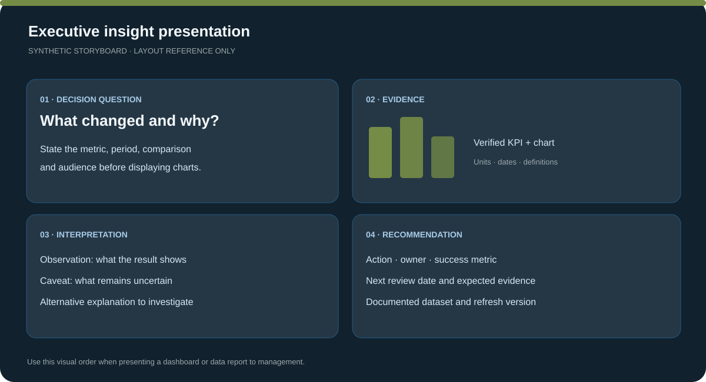

# Applied Statistics · Week 09 · Hypothesis testing, experiments and result interpretation

> DataLearning comprehensive practical lesson. Data is fictional. This worksheet supports the full in-app explanation and independent practice. Do not overwrite your raw source file.

## Learning outcome
Use clear hypotheses and effect sizes to decide whether an apparent change is meaningful.

## Where to begin in the tool
Define H0 and H1 before viewing results; use the appropriate statistical test and check assumptions.


## Source data dictionary · exact practice file fields
The linked CSV uses these **exact header names**. Import the file before attempting examples. If an exercise uses a friendly or calculated name, map or create it first.

`session_id, variant, converted, device, region, basket_items`

The worked example may introduce derived fields or example tables. Create or rename those fields explicitly and verify results against these original source columns.

## Dataset and companion video
- **Download the dataset:** [`learning_experiment.csv`](../learning_experiment.csv)
- **Video companion:** https://www.youtube.com/watch?v=vyX4m89VkyI (the in-app Watch button opens the YouTube player when embedding is permitted).
- **Reading order:** first identify controls, then read the four concepts, reproduce the example, try an independent case, and validate your evidence.

## Explain the four essential concepts
### 1. Null hypothesis
formalises a no-effect benchmark

### 2. P-values
measure incompatibility under the null and the test model

### 3. Practical significance
a tiny effect can be statistically significant yet operationally irrelevant

### 4. Multiple testing
repeated unplanned comparisons inflate false positives.

## Why this skill matters
Why this skill matters: A digital product team wants evidence before rolling out a new checkout design. The method is not only about producing an attractive figure. Practical significance: a tiny effect can be statistically significant yet operationally irrelevant Multiple testing: repeated unplanned comparisons inflate false positives. When preparing an output for another person, specify the reporting period, units, selection rules and known limitations. An analyst should be able to explain why a calculation or chart answers the actual business question and reproduce the result.

## Guided practice · follow all four steps
1. Open the correct workspace and identify the controls before entering commands. Define H0 and H1 before viewing results; use the appropriate statistical test and check assumptions. Keep an untouched source or backup version so a mistake is reversible.
2. Apply the first two concepts on a small example: Null hypothesis — formalises a no-effect benchmark Then test p-values with at least two contrasting inputs.
3. Reproduce the worked example below exactly, then change one input or filter. Explain which value changes and why. After that, apply practical significance and inspect the output for errors.
4. Complete the independent challenge: Write a one-paragraph interpretation of a test result including effect size and limitations. Before moving on, check the result against the acceptance criteria: At pre-specified alpha 0.05, reject H0 when p=0.03, subject to assumptions; do not call it proof of causation without design.

## Study this worked example
```text
H0: new checkout has equal conversion to old; p = 0.03 at alpha = 0.05
```

**How to interpret the output:** Hypothesis testing, experiments and result interpretation begins with a practical objective: Use clear hypotheses and effect sizes to decide whether an apparent change is meaningful. In Applied Statistics, begin by understanding the workspace and the data rather than memorising a command. Null hypothesis: formalises a no-effect benchmark P-values: measure incompatibility under the null and the test model Practice these ideas on a small synthetic sample first. Notice where the tool shows inputs, intermediate results and errors; then describe in plain language what each operation does and what it does not prove. Keep original records separate from working calculations so you can trace any surprising result back to its source.

## Business case study
Business case: A digital product team wants evidence before rolling out a new checkout design. Your role is to deliver a result that a manager can trust and act upon, not merely a screenshot. First describe what records are included and excluded. Next perform the method described in this week, and record any changes to the source. Use the worked example as a starting point but test it with different values; finally communicate one relevant observation, one limitation and a follow-up.

## Independent practical challenge
Write a one-paragraph interpretation of a test result including effect size and limitations.

**What you should hand in:** At pre-specified alpha 0.05, reject H0 when p=0.03, subject to assumptions; do not call it proof of causation without design.

## Check your result (after attempting)
Expected evidence: At pre-specified alpha 0.05, reject H0 when p=0.03, subject to assumptions; do not call it proof of causation without design. To validate it, compare a small hand-checked sample with the final output, test an alternative filter or a changed input, and record any unmatched, missing or suspicious data. If results differ, review the original data, formula or query, aggregation grain and selected filters before sharing the report. Avoid this common error: Interpreting p=0.03 as a 97% probability that the alternative hypothesis is true.

**Common failure:** Interpreting p=0.03 as a 97% probability that the alternative hypothesis is true.

## Reflect and explain the result
- Which menu, editor or pane did you use, and why?
- What is the data grain, metric definition or calculated rule?
- Can a second learner reproduce your output using the dataset and your instructions?
- Which number, chart or limitation must be mentioned when presenting your result?

## Management report presentation layout


Follow the order: decision question, verified evidence, interpretation and recommended action.

---
**Progress note:** Completing this worksheet is practice. Marking a week complete, passing an assessment and submitting an instructor-reviewed capstone are separate actions in DataLearning.
