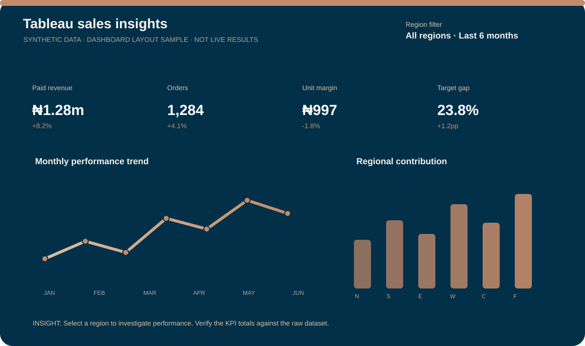

# Tableau · Week 08 · Building a Tableau dashboard with layout containers

> DataLearning comprehensive practical lesson. Data is fictional. This worksheet supports the full in-app explanation and independent practice. Do not overwrite your raw source file.

## Learning outcome
Combine worksheets, filters and actions into a premium interactive canvas.

## Where to begin in the tool
Choose New Dashboard, select a desktop size, and use horizontal and vertical layout containers.


## Source data dictionary · exact practice file fields
The linked CSV uses these **exact header names**. Import the file before attempting examples. If an exercise uses a friendly or calculated name, map or create it first.

`month, region, net_sales_ngn, sales_target_ngn, gross_profit_ngn, order_count, late_shipments, returned_orders`

The worked example may introduce derived fields or example tables. Create or rename those fields explicitly and verify results against these original source columns.

## Dataset and companion video
- **Download the dataset:** [`learning_monthly_kpis.csv`](../learning_monthly_kpis.csv)
- **Video companion:** https://www.youtube.com/watch?v=PSNXoAs2FtQ&t=29543s (the in-app Watch button opens the YouTube player when embedding is permitted).
- **Reading order:** first identify controls, then read the four concepts, reproduce the example, try an independent case, and validate your evidence.

## Explain the four essential concepts
### 1. Layout containers
align title, KPI strip, charts and a filter sidebar predictably

### 2. Actions
make selection and highlight behaviour intentional

### 3. Dashboard sizing
verify desktop and smaller displays using Device Preview

### 4. QA
compare headline KPIs with the underlying sheet calculations.

## Why this skill matters
Why this skill matters: An executive team needs an interactive monthly performance overview built from Tableau worksheets. The method is not only about producing an attractive figure. Dashboard sizing: verify desktop and smaller displays using Device Preview QA: compare headline KPIs with the underlying sheet calculations. When preparing an output for another person, specify the reporting period, units, selection rules and known limitations. An analyst should be able to explain why a calculation or chart answers the actual business question and reproduce the result.

## Guided practice · follow all four steps
1. Open the correct workspace and identify the controls before entering commands. Choose New Dashboard, select a desktop size, and use horizontal and vertical layout containers. Keep an untouched source or backup version so a mistake is reversible.
2. Apply the first two concepts on a small example: Layout containers — align title, KPI strip, charts and a filter sidebar predictably Then test actions with at least two contrasting inputs.
3. Reproduce the worked example below exactly, then change one input or filter. Explain which value changes and why. After that, apply dashboard sizing and inspect the output for errors.
4. Complete the independent challenge: Build a dashboard with two worksheets, three KPIs, a Region filter and an action that highlights a selection. Before moving on, check the result against the acceptance criteria: Region selection must update expected views; reset view restores the overall total.

## Study this worked example
```text
Top: Revenue | Orders | Margin
Middle: Sales Trend | Region Ranking
Bottom: Product Category | Filter/Insights panel
```

**How to interpret the output:** Building a Tableau dashboard with layout containers begins with a practical objective: Combine worksheets, filters and actions into a premium interactive canvas. In Tableau, begin by understanding the workspace and the data rather than memorising a command. Layout containers: align title, KPI strip, charts and a filter sidebar predictably Actions: make selection and highlight behaviour intentional Practice these ideas on a small synthetic sample first. Notice where the tool shows inputs, intermediate results and errors; then describe in plain language what each operation does and what it does not prove. Keep original records separate from working calculations so you can trace any surprising result back to its source.

## Business case study
Business case: An executive team needs an interactive monthly performance overview built from Tableau worksheets. Your role is to deliver a result that a manager can trust and act upon, not merely a screenshot. First describe what records are included and excluded. Next perform the method described in this week, and record any changes to the source. Use the worked example as a starting point but test it with different values; finally communicate one relevant observation, one limitation and a follow-up.

## Independent practical challenge
Build a dashboard with two worksheets, three KPIs, a Region filter and an action that highlights a selection.

**What you should hand in:** Region selection must update expected views; reset view restores the overall total.

## Check your result (after attempting)
Expected evidence: Region selection must update expected views; reset view restores the overall total. To validate it, compare a small hand-checked sample with the final output, test an alternative filter or a changed input, and record any unmatched, missing or suspicious data. If results differ, review the original data, formula or query, aggregation grain and selected filters before sharing the report. Avoid this common error: Placing every chart as floating objects and losing alignment on smaller screens.

**Common failure:** Placing every chart as floating objects and losing alignment on smaller screens.

## Reflect and explain the result
- Which menu, editor or pane did you use, and why?
- What is the data grain, metric definition or calculated rule?
- Can a second learner reproduce your output using the dataset and your instructions?
- Which number, chart or limitation must be mentioned when presenting your result?

## Dashboard design reference


Study the KPI strip, timeline, ranking, filters and notes. It is an illustrative wireframe, not a working dashboard or calculated analysis.

---
**Progress note:** Completing this worksheet is practice. Marking a week complete, passing an assessment and submitting an instructor-reviewed capstone are separate actions in DataLearning.
