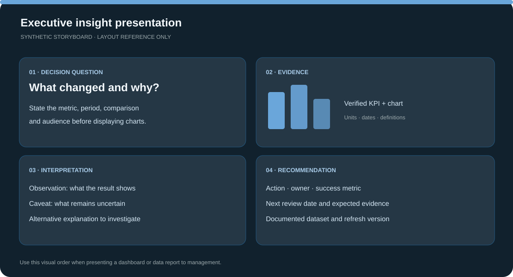

# Tableau · Week 09 · Creating Tableau stories and presenting findings

> DataLearning comprehensive practical lesson. Data is fictional. This worksheet supports the full in-app explanation and independent practice. Do not overwrite your raw source file.

## Learning outcome
Organise dashboard views into a sequence that supports an evidence-based recommendation.

## Where to begin in the tool
Use New Story and add key sheets or dashboard states; write captions for context, evidence and action.


## Source data dictionary · exact practice file fields
The linked CSV uses these **exact header names**. Import the file before attempting examples. If an exercise uses a friendly or calculated name, map or create it first.

`month, region, net_sales_ngn, sales_target_ngn, gross_profit_ngn, order_count, late_shipments, returned_orders`

The worked example may introduce derived fields or example tables. Create or rename those fields explicitly and verify results against these original source columns.

## Dataset and companion video
- **Download the dataset:** [`learning_monthly_kpis.csv`](../learning_monthly_kpis.csv)
- **Video companion:** https://www.youtube.com/watch?v=PSNXoAs2FtQ&t=29112s (the in-app Watch button opens the YouTube player when embedding is permitted).
- **Reading order:** first identify controls, then read the four concepts, reproduce the example, try an independent case, and validate your evidence.

## Explain the four essential concepts
### 1. Story points
show the decision question, key finding and recommended follow-up

### 2. Exporting
confirm fonts and filters remain legible in PDF or presentation

### 3. Accessibility
make colours and labels meaningful without relying on colour alone

### 4. Data caveats
document refresh date, exclusions and uncertainty.

## Why this skill matters
Why this skill matters: A regional director needs a short story rather than a crowded gallery of visualisations. The method is not only about producing an attractive figure. Accessibility: make colours and labels meaningful without relying on colour alone Data caveats: document refresh date, exclusions and uncertainty. When preparing an output for another person, specify the reporting period, units, selection rules and known limitations. An analyst should be able to explain why a calculation or chart answers the actual business question and reproduce the result.

## Guided practice · follow all four steps
1. Open the correct workspace and identify the controls before entering commands. Use New Story and add key sheets or dashboard states; write captions for context, evidence and action. Keep an untouched source or backup version so a mistake is reversible.
2. Apply the first two concepts on a small example: Story points — show the decision question, key finding and recommended follow-up Then test exporting with at least two contrasting inputs.
3. Reproduce the worked example below exactly, then change one input or filter. Explain which value changes and why. After that, apply accessibility and inspect the output for errors.
4. Complete the independent challenge: Present three Tableau story points with a headline, chart evidence and a recommendation for each. Before moving on, check the result against the acceptance criteria: Each claim can be traced to a calculated field or worksheet; changed filters are disclosed.

## Study this worked example
```text
Story point 1: Overall performance
Story point 2: Region behind target
Story point 3: Action & owner
```

**How to interpret the output:** Creating Tableau stories and presenting findings begins with a practical objective: Organise dashboard views into a sequence that supports an evidence-based recommendation. In Tableau, begin by understanding the workspace and the data rather than memorising a command. Story points: show the decision question, key finding and recommended follow-up Exporting: confirm fonts and filters remain legible in PDF or presentation Practice these ideas on a small synthetic sample first. Notice where the tool shows inputs, intermediate results and errors; then describe in plain language what each operation does and what it does not prove. Keep original records separate from working calculations so you can trace any surprising result back to its source.

## Business case study
Business case: A regional director needs a short story rather than a crowded gallery of visualisations. Your role is to deliver a result that a manager can trust and act upon, not merely a screenshot. First describe what records are included and excluded. Next perform the method described in this week, and record any changes to the source. Use the worked example as a starting point but test it with different values; finally communicate one relevant observation, one limitation and a follow-up.

## Independent practical challenge
Present three Tableau story points with a headline, chart evidence and a recommendation for each.

**What you should hand in:** Each claim can be traced to a calculated field or worksheet; changed filters are disclosed.

## Check your result (after attempting)
Expected evidence: Each claim can be traced to a calculated field or worksheet; changed filters are disclosed. To validate it, compare a small hand-checked sample with the final output, test an alternative filter or a changed input, and record any unmatched, missing or suspicious data. If results differ, review the original data, formula or query, aggregation grain and selected filters before sharing the report. Avoid this common error: Describing a visual association as the cause of a revenue shortfall.

**Common failure:** Describing a visual association as the cause of a revenue shortfall.

## Reflect and explain the result
- Which menu, editor or pane did you use, and why?
- What is the data grain, metric definition or calculated rule?
- Can a second learner reproduce your output using the dataset and your instructions?
- Which number, chart or limitation must be mentioned when presenting your result?

## Management report presentation layout


Follow the order: decision question, verified evidence, interpretation and recommended action.

---
**Progress note:** Completing this worksheet is practice. Marking a week complete, passing an assessment and submitting an instructor-reviewed capstone are separate actions in DataLearning.
